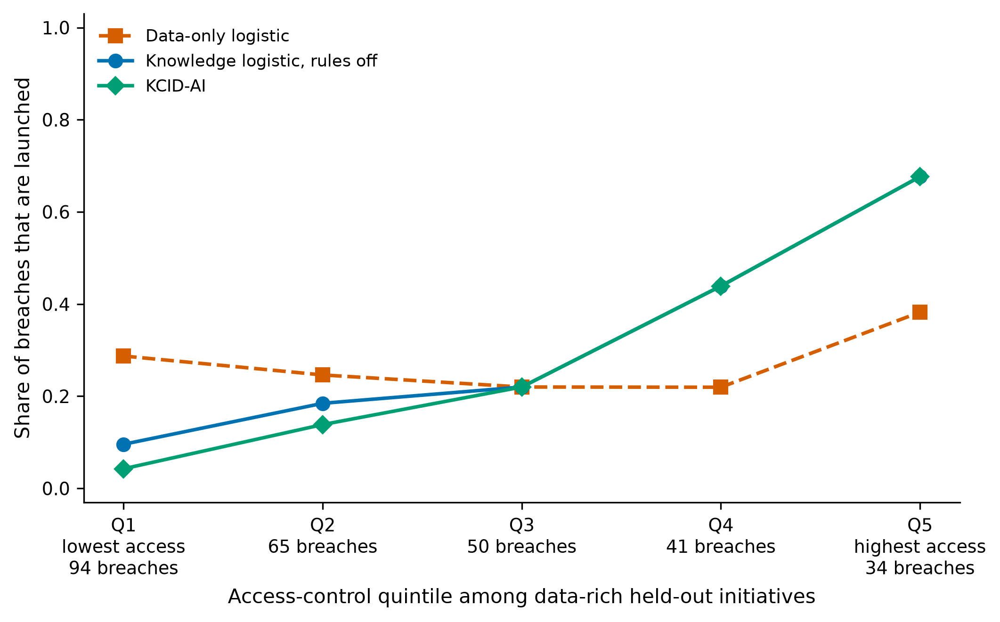

# A knowledge-based AI decision-support system for cybersecurity-aware digital transformation screening using innovation and entrepreneurship indicators

Sai Sowmith Repala^a,*

^a [Full affiliation, including department, institution, city and country.]

\* Corresponding author. E-mail: saisowmithrepala@midwest.edu

**Article type:** Research article

**Target journal:** *Knowledge-Based Systems*

Submit `highlights.txt` as a separate file. Do not paste the highlights into the article.

## Abstract

Digital transformation initiatives are often screened on innovation, entrepreneurship and data indicators. Those indicators describe opportunity. They do not record whether cybersecurity controls can protect the data an initiative concentrates. We ask whether cybersecurity indicators and explicit control rules contribute separately to a launch, harden or defer decision. KCID-AI pairs an L2-penalised logistic breach model with seven propositional rules. No public file links these indicators to breaches, so we use a synthetic population of 5,000 initiatives. On the seed-23 hold-out of 1,251 initiatives and 448 breaches, KCID-AI launches 170 breach-labelled initiatives, against 198 for logistic regression on opportunity indicators alone. Mean utility rises by 1.21 illustrative units (95% bootstrap interval 0.25 to 2.19). In 50 regenerated populations from this generator, the cybersecurity indicators raise utility every time (mean 1.80). The rules lower the launched-breach rate every time and lower utility in 44 of 50 (mean −0.18). A rule-only policy is worse on both criteria in every population. An expected-utility policy held to KCID-AI's expected-breach budget has higher utility in 46 of 50 populations and almost the same launched-breach rate. A hybrid that keeps the hard rules, but launches by that policy, matches the capped policy. In every population it covers fewer non-launches with a named rule and flags more launches. Under this generator the rules buy rule-consistent decisions, not a better utility–risk trade-off. Those statements use one breach equation and fixed model settings. On a second equation, which drops the clipped control gaps and the venture-gap term that repeats one rule, KCID-AI beats the opportunity model in 37 of 50 replications, not 50. Selecting the logistic penalty and the boosting settings, calibrating the probabilities, and freezing the budget price off the test set does not reverse the comparison on the original equation. The simulation does not show a real-world fall in breaches or a cash return.

**Keywords:** Knowledge-based systems; Decision support; Cybersecurity; Digital transformation; Innovation; Entrepreneurship; Explainable artificial intelligence

## 1. Introduction

Digital transformation changes products, processes and business models [1–3]. This paper studies a screen that uses innovation, entrepreneurship and data indicators. Those indicators describe the opportunity. They do not say whether the organisation can secure the data a new initiative concentrates.

Cybersecurity extends information security to people, assets and interests that depend on digital systems [4]. Transformation programmes enlarge the attack surface [5]. Many incidents come from human and organisational factors that technical spending alone does not fix [6]. Losses are heavy-tailed, and incident-level data are scarce, so the losses are hard to estimate [7]. Security investment is a trade-off between protection cost and expected loss [8]. Decision-support methods have been proposed for allocating security resources [9]. A review of risk assessment for SCADA systems shows how often those methods are built for one system class [10]. It does not give a screening rule for a portfolio of transformation initiatives. The NIST Cybersecurity Framework 2.0 states high-level outcomes and does not set numeric thresholds [11].

Machine learning in cybersecurity has focused on detection, including intrusion and malware detection [12,13]. Public benchmarks are mostly network traffic [14]. Explainability is now a standard requirement in security applications [15,16] and in responsible AI more broadly [17]. Knowledge-based and expert systems encode domain rules that a reader can check [18]. Informed machine learning puts that kind of prior knowledge into a learning pipeline [19]. Hybrid designs that combine a rule-based component with a learned policy exist in other domains [20]. In credit and churn work, logistic models remain an operational benchmark next to tree ensembles [21,22], and some evaluations score a decision by its value rather than by accuracy alone [23].

The papers cited above study digital transformation, security investment, detection, or hybrid decisions in other domains. They do not specify a launch, harden or defer screen that separates cybersecurity indicators inside a probability model from explicit constraints on the action. We ask whether those two mechanisms change screening outcomes in different ways.

We make three contributions. First, KCID-AI keeps a logistic risk score and a propositional rule layer as parts that can be switched separately. Second, a 2 × 2 comparison assigns changes in utility and in launched breaches to the features or to the rules. The other benchmarks are gradient boosting with and without the same rules, a rule-only policy, expected-utility policies with and without a breach budget, and a hybrid that keeps the hard rules but launches by the budgeted expected-utility rule. Third, the benchmark is synthetic and reproducible. We regenerate it for 50 populations and vary the payoff, penalty and threshold assumptions one at a time. We then repeat the comparison after selecting the model settings off the test set, and under a second breach equation that does not repeat a screening rule. We use synthetic initiatives because breach records linked to these indicators are not public [7,14], and a controlled generator makes the construction of the label known [24]. The contribution is a comparison of components. It is not a new learning algorithm, and it is not a gain over a deployed enterprise system.

## 2. Methodology

### 2.1 Indicators and screening policy

Each initiative *i* has eleven indicators on [0, 1]. Five opportunity indicators measure innovation intensity (*x*_inn), entrepreneurship orientation (*x*_ent), data volume (*x*_vol), data sensitivity (*x*_sens) and digital-transformation breadth (*x*_dt). Six cybersecurity indicators measure access control, encryption, monitoring, incident response, security skills and vendor control. Opportunity value *V* and breach impact *I* are fixed before any model is fit. Both are in illustrative utility units, not in currency:

*I* = 25 + 90 *x*_sens + 40 *x*_vol + 20 *x*_dt, (1)

*V* = 18 + 35 *x*_inn + 22 *x*_ent + 12 *x*_dt. (2)

For a predicted breach probability *p* and a cumulative soft-rule penalty *P*, the screening score is

*J* = *V* − *p I* − *P*. (3)

Unless a hard rule fires, the action is launch if *J* ≥ 10, harden if −5 ≤ *J* < 10, and defer if *J* < −5. *P* = 0 when the rule layer is off. A hard rule overrides the thresholds and forces deferral. The thresholds are policy choices for this study. They are not estimates from a business population.

For evaluation, *y* = 1 denotes a simulated breach. The realised payoff is *V* − *y I* for launch, 0.55*V* − 5 − 0.35 *y I* for harden, and 0 for defer. The hardening retention (55%), the cost (5) and the residual impact (35%) are assumptions. No intervention experiment supports them. The thresholds in Eq. (3) are heuristics. They were not chosen to maximise this payoff.

### 2.2 Knowledge-rule layer

The rule base is propositional. We evaluate the rules on each initiative. A fired rule does not create a fact that fires another rule, so this is not a chain of inference. Three hard rules force deferral:

- r1: *x*_sens > 0.70 and access control < 0.45.
- r2: *x*_sens > 0.82 and encryption < 0.40.
- r3: *x*_vol > 0.72, monitoring < 0.38 and *x*_sens > 0.50.

Four soft rules each add 8 to *P*. Penalties add up:

- r4: *x*_vol > 0.65 and monitoring < 0.42.
- r5: *x*_dt > 0.60 and incident response < 0.40.
- r6: *x*_ent > 0.70, skills < 0.45 and *x*_sens > 0.50.
- r7: *x*_sens > 0.60 and vendor control < 0.40.

We fixed these thresholds before computing any test metric. They are not NIST values [11]. Hard rules fire on 9.3% of the 5,000 initiatives. The predicates of r1–r5 and r7 do not appear as written in the breach equation in Section 3. The generator uses the same indicators, so those rules are not independent of the outcome. Rule r6 repeats the venture-gap cutoffs in that equation, so r6 is partly aligned with the benchmark by construction.

### 2.3 Models and component comparisons

The probability model is L2-penalised logistic regression with *C* = 1, after standardisation on the training sample [25]. The opportunity model uses the five opportunity indicators. The knowledge model adds the six cybersecurity indicators. Crossing the two feature sets with the rules off or on gives four policies. KCID-AI is the knowledge model with the rules on. The rules change the action. They do not change the predicted probability, so the area under the receiver operating characteristic curve (AUROC) is the same for every policy that shares a feature set.

Two gradient-boosting classifiers [26], one for each feature set, use 250 trees, a learning rate of 0.05, a maximum depth of 3 and a subsample fraction of 0.85. Those two policies do not use the rules. Tables 1 and 2 use these fixed values. They were not selected on a validation sample. Section 3.1 then selects both from a small grid, on the training data only. All six of these policies use Eq. (3) and the same thresholds.

Six further policies ask whether the rule layer adds anything beyond a flexible learner, a payoff-maximising rule, or the rules alone, and whether rules and payoff maximisation can be combined. Knowledge boosting with rules applies the same hard and soft rules to the knowledge-feature boosting probabilities. The direct expected-utility (EU) policy uses the knowledge logistic probability *p* and picks the action with the highest expected evaluation payoff. It does not use the thresholds in Eq. (3):

EU(launch) = *V* − *p I*,

EU(harden) = 0.55*V* − 5 − 0.35 *p I*,

EU(defer) = 0,

*a* = argmax EU(*a*) over launch, harden and defer. (4)

The EU policy with hard rules also forces deferral when r1, r2 or r3 fires. The capped EU policy charges a price *λ* ≥ 0 for each expected launched breach, so the launch payoff becomes *V* − *p I* − *λ p*. We set *λ* by bisection to the smallest value at which the sum of *p* over launched initiatives does not exceed KCID-AI's sum on the same portfolio. That search uses predicted probabilities only. It never uses outcomes. The portfolio is the one being scored, which in Tables 1 and 2 is the test set, so *λ* is not frozen on a separate sample. Section 3.1 freezes *λ* off the test set. The rule-only policy uses no probability model. It defers when a hard rule fires, hardens when any soft rule fires, and launches otherwise. The hybrid keeps the hard rules and the names of the soft rules, but it changes the action rule. Hard rules force deferral. The capped EU policy sets the remaining actions inside the same budget. Soft rules no longer change the action. They are reported as named control flags.

Two explanation measures apply to every policy. Reason coverage is the share of non-launched initiatives for which at least one rule fires. The flagged-launch share is the share of launches made while a soft rule flags a control gap. The analysis uses Python with scikit-learn 1.9.1 [27,28], NumPy 2.5.4, pandas 3.1.0 and matplotlib 3.11.2.

## 3. Simulation and evaluation design

Seed 23 generates 5,000 initiatives from four independent standard-normal latent factors for innovation, entrepreneurship, data intensity and control maturity. Breadth also loads on innovation and data. Indicators are logistic transforms of these factors plus noise. The latent breach log-odds rise with sensitivity, volume, breadth and entrepreneurship. They also rise with three control-gap terms, which are sensitivity minus access, volume minus monitoring, and an encryption gap at high sensitivity, and with the venture-gap indicator. They fall slightly with access and monitoring. The intercept is set by bisection so that the mean latent probability is 0.36. The realised prevalence is 0.358. The coefficients are listed in `code/analysis_published.py`. They are not printed in this manuscript.

A stratified split gives 3,749 training and 1,251 test initiatives, with 448 test breaches. Fitting and standardisation use the training data only. The subgroup is defined from training-sample quantiles before any test metric is computed: data volume at or above the training median (0.493) and access control at or below the training 40th percentile (0.435). It contains 256 test initiatives and 156 breaches. It was not registered outside this study.

The outcomes are AUROC, launched breaches (breaches assigned to launch), breach prevalence among launches, and mean realised utility. Paired bootstrap intervals use 1,000 resamples of the test set (seed 24). They describe uncertainty given this population and these fitted models. They do not describe variability across generator settings, training samples or organisations. Intervals in Fig. 1 are Wilson score intervals [29].

Two sensitivity analyses cover dependence on one population and on constants we chose. First, the whole pipeline is regenerated for seeds 1 to 50. The pipeline is the population, the split, the subgroup cutoffs, the fits and the evaluation. The boosting random state equals the replication seed. Seed 23 is one of those 50 seeds, and it reproduces the reported run. Table 1 is the seed-23 replication inside that set, not an extra sample. We summarise replications by means, 2.5th to 97.5th percentiles and sign counts. Second, on the seed-23 fits, we vary one parameter at a time around its base value: harden value retention (0.40 to 0.70; base 0.55), harden cost (0 to 10; base 5), residual impact after hardening (0.15 to 0.55; base 0.35), soft-rule penalty (0 to 16; base 8), launch threshold (5 to 15; base 10) and defer threshold (−15 to 0; base −5). These ranges give 26 distinct settings. The first three parameters change the evaluation payoff, and they change the actions of the expected-utility policies. The last three change the actions of the threshold policies.

### 3.1 Pre-specified checks

Three checks were fixed before their test results were inspected. They do not retune the rules, the payoffs or the thresholds. `code/run_corrections.py` runs them under the library versions in Section 2.3.

The corrected protocol splits each training sample, before any test metric, into a fit sample (80%) and a validation sample (20%), stratified on the breach label. The validation split seed is the replication seed plus 7,919. Logistic *C* is chosen from {0.1, 1, 10} by mean log loss in stratified 3-fold cross-validation on the fit sample. Boosting is chosen the same way from two candidates: the published setting, and a smaller one with 100 trees, a learning rate of 0.10, a maximum depth of 2 and the same subsample of 0.85. The selected models are fit on the fit sample only. A Platt map, a logistic regression with *C* = 10^6 of the label on the logit of the predicted probability, is fit on the validation sample only and applied to the test probabilities. Subgroup cutoffs are the fit-sample quantiles. The capped policy's *λ* is bisected on the validation sample, then frozen. Because the fit sample is smaller than the training sample in Tables 1 and 2, corrected utilities are not paired with those tables. Contrasts are compared within a protocol.

A second check keeps the published probabilities and moves only *λ*. It is bisected on in-sample training predictions and then applied to the test set. Those predictions are not held out. The check asks whether fitting *λ* on the test portfolio changes the comparison. It is not a validation sample.

The alternative generator uses the same indicators, the same payoff formulas and the same target mean latent probability of 0.36. It drops the clipped control-gap terms and the venture-gap indicator that repeats rule r6. Breach log-odds then depend on sensitivity, volume, breadth and entrepreneurship, on main effects of access, monitoring and encryption, and on three smooth shortfalls: sensitivity times one minus access, volume times one minus monitoring, and sensitivity times one minus encryption. The coefficients are in `code/run_corrections.py`. They were not changed after the run. The rules are unchanged, so r6 no longer copies a term in the label.

## 4. Results

### 4.1 Indicator structure and risk gradient

Supplementary Table S1 reports the means, standard deviations and breach correlations of the eleven simulated indicators. Innovation and entrepreneurship have near-zero correlations with breach (−0.002 and 0.019). Data volume and sensitivity have positive correlations (0.208 and 0.282). All six cybersecurity indicators have negative correlations (−0.180 to −0.240). These associations are built into the generator. They are not estimated effects of real controls.

Fig. 1 shows why the opportunity indicators cannot stand in for control knowledge. Among the 656 data-rich test initiatives, breach prevalence falls from 94/131 = 0.718 in the lowest access-control quintile (95% Wilson interval 0.635 to 0.788) to 34/132 = 0.258 in the highest (0.191 to 0.338). Mean opportunity-model probabilities stay between 0.434 and 0.458. Knowledge-model probabilities fall from 0.651 to 0.257 and track the observed gradient.

**Fig. 1.** Observed breach prevalence and mean predicted probabilities by access-control quintile among 656 data-rich test initiatives (quintile sizes 131, 131, 131, 131 and 132). Points are observed rates with 95% Wilson intervals. The dashed line is the opportunity logistic model, labelled “Data-only score” in the figure. The solid line is the knowledge logistic model.

### 4.2 Feature and rule contributions

Table 1 separates the feature contribution from the rule contribution on seed 23. KCID-AI and the opportunity logistic model launch similar shares of initiatives (60.6% and 60.9%). Launched breaches fall from 198/448 to 170/448. The paired difference in the launched-breach rate is −0.062 (95% interval −0.102 to −0.024). Mean utility rises from 20.05 to 21.26, a difference of 1.21 (0.25 to 2.19). In the subgroup, launched breaches fall from 43/156 to 13/156 (−0.192; −0.257 to −0.131). Breach prevalence among subgroup launches falls from 43/98 to 13/43.

**Table 1.** Held-out screening results (n = 1,251; 448 breaches).

| Policy | Features | Rules | AUROC | Launched breaches | Breach prevalence among launches | Mean utility | Subgroup launched breaches |
|---|---|---|---:|---:|---:|---:|---:|
| Opportunity logistic | Opportunity | Off | 0.691 | 198/448 | 0.260 | 20.05 | 43/156 |
| Opportunity boosting | Opportunity | Off | 0.677 | 227/448 | 0.275 | 19.65 | 52/156 |
| Knowledge logistic | Opportunity + cybersecurity | Off | 0.728 | 180/448 | 0.232 | 21.27 | 21/156 |
| Knowledge boosting | Opportunity + cybersecurity | Off | 0.714 | 211/448 | 0.251 | 20.83 | 23/156 |
| Opportunity logistic + rules | Opportunity | On | 0.691 | 180/448 | 0.247 | 20.27 | 33/156 |
| KCID-AI | Opportunity + cybersecurity | On | 0.728 | 170/448 | 0.224 | 21.26 | 13/156 |
| Knowledge boosting + rules | Opportunity + cybersecurity | On | 0.714 | 205/448 | 0.248 | 20.74 | 19/156 |
| Expected-utility | Opportunity + cybersecurity | Off | 0.728 | 184/448 | 0.230 | 21.81 | 22/156 |
| Expected-utility + hard rules | Opportunity + cybersecurity | Hard only | 0.728 | 184/448 | 0.230 | 21.82 | 22/156 |
| Expected-utility, capped | Opportunity + cybersecurity | Off | 0.728 | 172/448 | 0.226 | 21.56 | 16/156 |
| Rule-only | Cybersecurity rules only | On | — | 265/448 | 0.275 | 19.36 | 25/156 |
| Hybrid (hard rules + capped expected-utility) | Opportunity + cybersecurity | Hard only | 0.728 | 172/448 | 0.226 | 21.56 | 16/156 |

*Note.* The subgroup has 256 test initiatives (156 breaches) with data volume ≥ 0.493 and access control ≤ 0.435. Launched-breach counts use all breaches as the denominator. Prevalence among launches uses launches as the denominator. Rules leave AUROC unchanged. The last six rows are the additional policies in Section 2.3. The expected-utility policies use the knowledge logistic probabilities and Eq. (4), not the thresholds. The rule-only policy has no probability model. Utility is in illustrative units. The opportunity-logistic-plus-rules utility of 20.27 was not bootstrapped.

With the rules off, adding the cybersecurity indicators raises mean utility by 1.22 (0.30 to 2.14) and lowers the launched-breach rate by 0.040 (−0.078 to −0.004). Adding the rules to the knowledge model then cuts launched breaches from 180 to 170, a rate difference of −0.022 (−0.037 to −0.011), and cuts subgroup launched breaches from 21 to 13. The exact subgroup difference is −8/156 = −0.051 (bootstrap interval −0.089 to −0.020). The bootstrap mean change in utility is −0.006 (−0.28 to 0.25). The interval includes both signs, so it shows neither a gain nor a loss. The utilities in Table 1 round to 21.27 and 21.26. Rules on the opportunity model also reach 180 launched breaches, at a point-estimate utility of 20.27.

Relative to knowledge boosting (211 launched breaches, utility 20.83), KCID-AI has a utility difference of 0.43 (−0.29 to 1.23) and a subgroup difference of −0.064 (−0.108 to −0.021). Adding the rules to boosting cuts its launched breaches from 211 to 205 (−0.013; −0.024 to −0.004), with a utility change of −0.09 (−0.35 to 0.16). KCID-AI still launches fewer (−0.078; −0.106 to −0.049). The expected-utility policy has the highest utility in Table 1 (21.81) and launches 184 breaches. Relative to it, KCID-AI loses 0.55 utility (−1.06 to −0.04) and launches fewer breaches overall (−0.031; −0.049 to −0.013) and in the subgroup (−0.058; −0.096 to −0.027). Adding the hard rules to the expected-utility policy does not change the launch count on this seed. Both rows launch 184 breaches, because that policy already declines to launch the initiatives the hard rules exclude. The utilities round to 21.81 and 21.82. At the same expected-breach budget as KCID-AI, the capped policy launches 172 breaches, 16 of them in the subgroup, with utility 21.56. Its differences from KCID-AI include zero for utility (−0.30; −0.77 to 0.19), for launched breaches (−0.004; −0.020 to 0.012) and for the subgroup (−0.019; −0.056 to 0.014). The rule-only policy launches 77% of initiatives, including 265 breaches, with utility 19.36. KCID-AI improves on it in utility (1.90; 0.52 to 3.30) and in launched breaches (−0.212; −0.258 to −0.165).

The hybrid launches the same number of initiatives as the capped policy, and the same number of breaches. On this seed its hard rules move 17 initiatives from harden to defer. Both utilities round to 21.56. Its explanations are weaker than KCID-AI's. Of the initiatives it does not launch, 47.3% carry a named rule, against 49.3% for KCID-AI (difference 0.020; 0.009 to 0.033). Of its launches, 7.4% carry a soft-rule flag, against 5.9% for KCID-AI (−0.014; −0.023 to −0.007).

### 4.3 Where the launches move

Fig. 2 locates the changes among data-rich test initiatives that do breach. In the lowest access quintile (94 breaches), the opportunity logistic model, the knowledge logistic model and KCID-AI launch 0.287, 0.096 and 0.043 of those breaches. In the highest quintile (34 breaches), the shares are 0.382, 0.676 and 0.676. Launches move from low-access breaches toward high-access breaches. The rules bind in the low-access quintiles, where KCID-AI separates from the knowledge model. From the third quintile upward the two knowledge curves meet.

**Fig. 2.** Share of breach-labelled initiatives that each policy launches, within the access-control quintiles of Fig. 1 (breach counts 94, 65, 50, 41 and 34). The knowledge logistic model and KCID-AI coincide from the third quintile upward. Points have no uncertainty intervals.

### 4.4 Robustness to the seed and to the payoff and policy assumptions

Table 2 summarises the 50 regenerated populations. The feature effect replicates without exception. Adding the cybersecurity indicators raises mean utility in all 50 replications (paired mean 1.80; 2.5th to 97.5th percentile 0.99 to 2.60). KCID-AI exceeds the opportunity logistic model in all 50 (mean 1.62). The rule layer lowers the launched-breach rate relative to the knowledge logistic model in all 50 (mean −0.020). It lowers subgroup launched breaches in 48 replications and leaves them unchanged in the other two. Its utility effect is negative in 44 of 50 (mean −0.18; −0.41 to 0.09). The same pattern appears when the rules are added to boosting. Launched breaches fall in all 50 replications (mean −0.021) and utility falls in 40 (mean −0.10).

KCID-AI launches fewer breaches in all 50 replications than the opportunity logistic model, the knowledge logistic model, both boosting policies, both uncapped expected-utility policies and the rule-only policy. It does not do so against every policy. Against the capped policy it launches fewer breaches in 30 replications, more in 15 and the same number in 5. Against the hybrid the counts are 30, 16 and 4. KCID-AI has the higher utility in all 50 replications against the opportunity logistic model and against the rule-only policy, and not against the other policies in Table 2.

The expected-utility policy has the highest mean utility. It exceeds KCID-AI in 49 of 50 replications by a mean of 0.48 (0.10 to 0.82) and launches more breaches (mean difference 0.038). Adding the hard rules to that policy changes launched breaches in only 5 replications and leaves utility nearly unchanged (mean −0.006). The seed-23 utility advantage of KCID-AI over boosting does not generalise. At an equal expected-breach budget, the capped policy launches almost as many breaches as KCID-AI (mean difference −0.002, KCID-AI minus capped) and has higher utility in 46 of 50 replications (mean 0.29; 2.5th to 97.5th percentile −0.17 to 0.65). Capping costs the uncapped policy 0.20 utility units on average and removes 0.036 from the launched-breach rate. The rule-only policy is dominated. KCID-AI has higher utility and fewer launched breaches in all 50 replications (mean differences 1.72 and −0.204).

The hybrid inherits the capped policy's utility. It has higher utility than KCID-AI in 46 of 50 replications (mean 0.28), with almost the same launched-breach rate, and its paired mean utility differs from the capped policy by less than 0.01. It does not inherit KCID-AI's rule consistency. In all 50 replications, KCID-AI has higher reason coverage (mean 0.498 against 0.479) and a lower flagged-launch share (0.058 against 0.073). Table 2 does not include the opportunity boosting policy or the opportunity model with rules. Those two rows of Table 1 were not regenerated.

**Table 2.** Policy outcomes across 50 regenerated populations (seeds 1–50).

| Policy | Mean utility | Launched-breach rate | Subgroup launched-breach rate | Replications with higher KCID-AI utility | Replications with fewer KCID-AI launched breaches |
|---|---:|---:|---:|---:|---:|
| Opportunity logistic | 19.20 (18.02–20.94) | 0.454 (0.407–0.510) | 0.261 (0.194–0.337) | 50/50 | 50/50 |
| Knowledge logistic | 21.00 (19.81–22.95) | 0.406 (0.359–0.451) | 0.111 (0.056–0.191) | 6/50 | 50/50 |
| Knowledge boosting | 21.13 (19.70–22.98) | 0.463 (0.402–0.502) | 0.140 (0.082–0.223) | 8/50 | 50/50 |
| Knowledge boosting + rules | 21.04 (19.75–22.66) | 0.442 (0.383–0.484) | 0.114 (0.065–0.181) | 15/50 | 50/50 |
| Expected-utility | 21.30 (20.14–23.25) | 0.424 (0.375–0.465) | 0.118 (0.065–0.211) | 1/50 | 50/50 |
| Expected-utility + hard rules | 21.29 (20.16–23.23) | 0.423 (0.375–0.465) | 0.118 (0.065–0.211) | 1/50 | 50/50 |
| Expected-utility, capped | 21.11 (19.82–22.96) | 0.388 (0.343–0.428) | 0.093 (0.044–0.179) | 4/50 | 30/50 |
| Rule-only | 19.10 (17.52–20.70) | 0.590 (0.543–0.629) | 0.210 (0.147–0.280) | 50/50 | 50/50 |
| Hybrid | 21.10 (19.85–22.95) | 0.388 (0.343–0.428) | 0.093 (0.044–0.179) | 4/50 | 30/50 |
| KCID-AI | 20.82 (19.66–22.66) | 0.386 (0.341–0.433) | 0.087 (0.039–0.152) | — | — |

*Note.* Entries are means across replications, with 2.5th–97.5th percentiles in parentheses. The last two columns count replications in which the paired difference favours KCID-AI. Against the capped policy, KCID-AI launches more breaches in 15 replications and the same number in 5. Against the hybrid, those counts are 16 and 4. Each replication regenerates the population, the split, the subgroup cutoffs and the fits. `code/sensitivity_published.py` produces the values.

Supplementary Note S1 and Fig. S1 vary the payoff and policy constants on the seed-23 fits. The feature effect is positive in all 26 settings (0.68 to 1.58). The rules' utility effect changes sign (−0.25 to 0.23). The soft penalties, not the hard exclusions, drive the rule-based drop in launched breaches. The capped and hybrid policies have higher utility than KCID-AI in 20 of the 26 settings. Where hardening is attractive, the uncapped expected-utility policy already launches fewer breaches than KCID-AI.

### 4.3 Selection, calibration, a frozen price, and a second generator

Re-running the published protocol under the library versions in Section 2.3 reproduces the seed-23 KCID-AI utility of 21.26 and the Table 2 means to the reported rounding. The checks below do not replace Tables 1 and 2.

The same 50 seeds were run again on a second machine, with the same pinned library versions. Every column that does not come from gradient boosting matched. The boosting columns did not. On that machine the published boosting policy has mean utility 21.15 on the original generator (2.5th to 97.5th percentile 19.78 to 22.94), against 21.13 (19.70 to 22.98) in Table 2. KCID-AI has the higher utility in 9 replications rather than the 8 in Table 2. Boosting still launches more breaches in all 50. The corrected boosting model still has higher utility than KCID-AI in 41 of 50 and still launches more breaches in all 50. Both machines select *C* = 0.1 and the smaller boosting candidate in all 50 replications of both generators. The second-machine file is `results_new/cloud_full50_replications.csv`.

On the original generator, the corrected protocol selects *C* = 0.1 for both logistic models in all 50 replications. It selects the smaller boosting candidate in all 50. The published boosting setting was the other candidate, and it was never selected. The direction of the main contrasts does not change (Table 3). Adding the cybersecurity indicators raises utility in all 50 replications (mean 1.85; 2.5th to 97.5th percentile 0.98 to 2.65). The rules lower the launched-breach rate in all 50 (mean −0.022; −0.038 to −0.009) and lower utility in 44 (mean −0.15; −0.34 to 0.15). They lower subgroup launched breaches in 48 replications and leave them unchanged in two. KCID-AI still beats the opportunity model on utility in all 50 (mean 1.70) and launches fewer breaches in all 50. The uncapped expected-utility policy has higher utility in 47 of 50 (mean 0.41; −0.09 to 0.87) and launches more breaches in all 50. With *λ* frozen on the validation sample, the capped policy has higher utility in 41 of 50 (mean 0.23; −0.16 to 0.61). Its launched-breach comparison is a split: more breaches in 23 replications, fewer in 24 and the same number in 3. The mean difference in the launched-breach rate is 0.002.

The knowledge-model probabilities did not need the Platt map. Before calibration, the test-set slope has mean 1.00 (0.86 to 1.16), the intercept has mean 0.003 (−0.06 to 0.09), and the 10-bin expected calibration error has mean 0.057 (0.041 to 0.076). After the Platt map the error has mean 0.058. It is lower in 22 replications and higher in 28. The Brier score changes by +0.0002. Calibrated KCID-AI utility minus raw KCID-AI utility has mean 0.05 (−0.15 to 0.33): higher in 30 replications, lower in 19 and equal in 1.

Freezing *λ* on in-sample training predictions, while keeping the published probabilities, changes utility relative to the test-set *λ* by a mean of −0.006 (−0.18 to 0.16). The training-frozen capped policy is higher in 23 replications, lower in 25 and equal in 2. It still has higher utility than KCID-AI in 45 of 50 (mean 0.28). Fitting *λ* on the test portfolio is not what produces the capped policy's advantage. The training predictions are not a held-out sample. The validation freeze above is the cleaner of the two checks.

The alternative generator changes the claim that does not survive. Under the corrected protocol, the cybersecurity indicators raise utility in 48 of 50 replications (mean 0.68; 0.01 to 1.43), not in all 50. KCID-AI beats the opportunity model on utility in 37 of 50 (mean 0.36; −0.37 to 1.29). The rules still lower the launched-breach rate in all 50 (mean −0.033; −0.052 to −0.020) and lower utility in 46 (mean −0.32; −0.67 to 0.07). They lower subgroup launched breaches in all 50. KCID-AI beats the rule-only policy on utility in 49 of 50. The validation-frozen capped policy has higher utility than KCID-AI in 46 of 50 (mean 0.41; −0.13 to 0.75). On this equation the hard rules are no longer free. Under the corrected protocol the hybrid has lower utility than the capped policy by a mean of 0.10 (−0.31 to 0.09) and is higher in only 12 of 50. The same difference is −0.005 on the original generator under the published protocol and 0.001 under the corrected protocol. Under the published protocol, putting the same rules on the opportunity model raised utility in all 50 original replications (mean 0.33). On the alternative generator it does not (mean −0.05; higher in 21 and lower in 29), although it still lowers the launched-breach rate in all 50.

**Table 3.** Paired utility differences under the published protocol and the pre-specified checks.

| Contrast | Original, published | Original, corrected | Alternative, corrected |
|---|---|---|---|
| Knowledge − opportunity | 1.80 (0.99 to 2.60); 50/50 | 1.85 (0.98 to 2.65); 50/50 | 0.68 (0.01 to 1.43); 48/50 |
| KCID-AI − opportunity | 1.62 (0.80 to 2.54); 50/50 | 1.70 (0.83 to 2.60); 50/50 | 0.36 (−0.37 to 1.29); 37/50 |
| KCID-AI − knowledge | −0.18 (−0.41 to 0.09); 6/50 | −0.15 (−0.34 to 0.15); 6/50 | −0.32 (−0.67 to 0.07); 4/50 |
| Capped expected-utility − KCID-AI | 0.29 (−0.17 to 0.65); 46/50 | 0.23 (−0.16 to 0.61); 41/50 | 0.41 (−0.13 to 0.75); 46/50 |
| Uncapped expected-utility − KCID-AI | 0.48 (0.10 to 0.82); 49/50 | 0.41 (−0.09 to 0.87); 47/50 | 0.49 (−0.003 to 0.94); 48/50 |
| KCID-AI − rule-only | 1.72 (0.65 to 2.83); 50/50 | 1.76 (0.65 to 2.91); 50/50 | 1.16 (0.31 to 2.14); 49/50 |

*Note.* Each entry is the mean paired difference, the 2.5th to 97.5th percentile, and the number of replications in which the difference is positive. The published column uses the test-set *λ* from Table 2. The corrected columns freeze *λ* on the validation sample and fit on 80% of the training split, so their utility levels are not paired with Table 2. `code/run_corrections.py` writes `results_new/full50_replications.csv`.

## 5. Discussion and limitations

The results separate two mechanisms that hybrid designs often combine [19,20]. On the original generator, cybersecurity information in the score accounts for the utility gain in every replication and every payoff setting we examined. On the second generator that gain is smaller and is negative in 2 of 50 corrected replications (Table 3). The pattern on the original generator fits the economic view that security value comes from a better-targeted estimate of expected loss [8,9]. The rules keep removing further breach-labelled launches where control gaps are severe. Their utility effect is small, negative in 44 of 50 replications on the original generator, and the corrected fits give the same count. On the second generator they lower utility in 46 of 50. The effect also changes sign when the payoffs change. The rules work as a readable cap on launches the organisation is unwilling to accept, and they state the reason for a deferral. On the utility–risk comparison in Table 2, they are not the efficient cap.

A rule that forces deferral states its condition. A shift in probability does not. Surveys of explainable security treat that kind of readability as a requirement [15–17]. Those surveys do not test these seven rules.

The added baselines make the trade-off concrete. The expected-utility policy has the highest utility in almost every replication. That is what the design implies. The thresholds in Eq. (3) are not utility-optimal. The expected payoff is *V* − *p I* for launch and 0.55*V* − 5 − 0.35 *p I* for harden, so the difference is 0.45*V* + 5 − 0.65 *p I*. That difference is not a function of *J* alone. Given the same expected-breach budget, a payoff-maximising policy launches almost as many breaches and recovers most of the utility. In this population, KCID-AI is not on the efficient utility–risk frontier. What it keeps is rule consistency and a policy that can be stated without a shadow price. The rule-only policy is dominated, so the probability model is necessary. The rules are useful only as a complement to it.

Boosting, with or without the rules, launches more breach-labelled initiatives than KCID-AI in every replication of the published protocol. Its mean utility is higher (Table 2). The seed-23 utility gap in favour of KCID-AI does not survive the 50 seeds. Logistic models are also used as readable benchmarks against tree ensembles in credit scoring and churn [21,22]. Those papers do not study this screening payoff. The boosting settings in Table 2 were not tuned. A two-point search on the training split selects the smaller candidate in all 50 replications of both generators. On the original generator that selected model still launches more breaches than KCID-AI in every replication and has higher utility in 41 of 50. The second machine in Section 4.3 gives the same 41 of 50. It does not reproduce the published boosting utilities in Table 2 to the reported rounding.

The hybrid reaches the capped policy's utility. Its hard rules rarely change a launch, and its soft rules no longer act, so it launches more initiatives that still carry a named control gap. The choice between KCID-AI and the hybrid is a governance choice: whether a soft-rule flag may sit on a launched initiative. Across the 50 populations that choice is associated with a mean utility difference of 0.28 illustrative units per initiative. Decision-value metrics are one way to price a constraint of that kind [23]. The number 0.28 is not a market price.

Several limits remain. The 50 replications change the random draws. Section 4.3 changes the breach equation once. It does not change the indicator model, the rules or the payoffs, and it does not vary those pieces together. Rule r6 overlaps the original generator. The other rules share related inputs, and they remain in the alternative generator even though r6 no longer copies a label term. The payoff and policy constants were varied one at a time on one population, not together and not on the second equation. The expected-utility policies are favoured by construction, because they optimise the payoffs used for scoring. Choosing *λ* on the test portfolio does not create their utility advantage over KCID-AI. Freezing it on training predictions changes mean utility by −0.006, and freezing it on a validation sample still leaves the capped policy ahead in 41 of 50 replications on the original generator. The knowledge-model probabilities were already close to calibrated, and the Platt map did not improve the test scores. No real incident data were used. Such data remain hard to obtain [7,14]. The boosting search had two candidates. It is not a search over the wider boosting family. A second machine with the same seeds and the same library versions reproduced the logistic, rule, and expected-utility columns and did not reproduce the boosting columns.

## 6. Conclusion

KCID-AI separates cybersecurity information in a logistic score from explicit screening constraints. The study is synthetic. On the original generator, the cybersecurity indicators account for the utility gain in all 50 regenerated populations and in every payoff setting we varied. The rules reduce launched breaches in every replication. They lower utility in 44 of 50, and rules without a probability model are dominated on both criteria. An expected-utility policy given the same expected-breach budget has almost the same launched-breach rate and higher utility in 46 of 50 replications when its price is fit on the test set, and in 41 of 50 when that price is frozen on a validation sample. It also launches more initiatives that carry a flagged control gap. Selecting the model settings and calibrating the probabilities does not change this comparison. On a second breach equation the feature gain is smaller, and KCID-AI beats the opportunity model in 37 of 50 replications. The rules still cut launched breaches in every replication of that equation, and the budgeted policy still has higher utility in 46 of 50. KCID-AI's contribution in these generators is rule-consistent, auditable screening at a utility cost, not a more efficient trade-off. Before any claim about enterprise use, the rules should be checked against NIST-aligned organisational assessments [11], the payoffs should be taken from incident-cost evidence [7], the payoff constants should be varied jointly with the generator, and decision makers should be asked whether the rule consistency is worth the utility cost.

## CRediT authorship contribution statement

Sai Sowmith Repala: Conceptualization, Methodology, Software, Validation, Formal analysis, Investigation, Data curation, Writing – original draft, Writing – review & editing, Visualization.

## Declaration of competing interest

The author declares that there are no known competing financial interests or personal relationships that could have appeared to influence the work reported in this paper.

## Funding

This research did not receive any specific grant from funding agencies in the public, commercial, or not-for-profit sectors.

## Data availability

The files for this article are at https://github.com/saisowmithrepalamo/kb-ai-dt-readiness/tree/kcid-corrected-checks/kcid-full-revision. Seed 23, Table 1, Supplementary Table S1 and Figs. 1–2 come from `code/analysis_published.py`. Table 2 and Supplementary Fig. S1 come from `code/sensitivity_published.py`; the figure file in this folder was drawn from `results_original/sensitivity_results.json`. Table 3 comes from `code/run_corrections.py` (`results_new/full50_replications.csv`). The second-machine boosting check is `results_new/cloud_full50_replications.csv`. No human-participant data and no real enterprise breach records were used.

## Declaration of generative AI and AI-assisted technologies in the manuscript preparation process

During the preparation of this work the author used Cursor, ChatGPT (OpenAI) and Claude (Anthropic) to assist with drafting language, organising analysis code, formatting, and checking reference metadata. After using these tools, the author reviewed and edited the content as needed and takes full responsibility for the content of the published article.

## References

[1] G. Vial, Understanding digital transformation: A review and a research agenda, J. Strateg. Inf. Syst. 28 (2019) 118–144. https://doi.org/10.1016/j.jsis.2019.01.003.

[2] S. Nambisan, Digital entrepreneurship: Toward a digital technology perspective of entrepreneurship, Entrep. Theory Pract. 41 (2017) 1029–1055. https://doi.org/10.1111/etap.12254.

[3] A. Bharadwaj, O.A. El Sawy, P.A. Pavlou, N. Venkatraman, Digital business strategy: Toward a next generation of insights, MIS Q. 37 (2013) 471–482. https://doi.org/10.25300/MISQ/2013/37:2.3.

[4] R. von Solms, J. van Niekerk, From information security to cyber security, Comput. Secur. 38 (2013) 97–102. https://doi.org/10.1016/j.cose.2013.04.004.

[5] S. Saeed, S.A. Altamimi, N.A. Alkayyal, E. Alshehri, D.A. Alabbad, Digital transformation and cybersecurity challenges for businesses resilience: Issues and recommendations, Sensors 23 (2023) 6666. https://doi.org/10.3390/s23156666.

[6] K. Khando, S. Gao, S.M. Islam, A. Salman, Enhancing employees information security awareness in private and public organisations: A systematic literature review, Comput. Secur. 106 (2021) 102267. https://doi.org/10.1016/j.cose.2021.102267.

[7] M. Eling, J. Wirfs, What are the actual costs of cyber risk events?, Eur. J. Oper. Res. 272 (2019) 1109–1119. https://doi.org/10.1016/j.ejor.2018.07.021.

[8] L.A. Gordon, M.P. Loeb, The economics of information security investment, ACM Trans. Inf. Syst. Secur. 5 (2002) 438–457. https://doi.org/10.1145/581271.581274.

[9] A. Fielder, E. Panaousis, P. Malacaria, C. Hankin, F. Smeraldi, Decision support approaches for cyber security investment, Decis. Support Syst. 86 (2016) 13–23. https://doi.org/10.1016/j.dss.2016.02.012.

[10] Y. Cherdantseva, P. Burnap, A. Blyth, P. Eden, K. Jones, H. Soulsby, K. Stoddart, A review of cyber security risk assessment methods for SCADA systems, Comput. Secur. 56 (2016) 1–27. https://doi.org/10.1016/j.cose.2015.09.009.

[11] National Institute of Standards and Technology, The NIST Cybersecurity Framework (CSF) 2.0, NIST Cybersecurity White Paper (CSWP) 29, Gaithersburg, MD, 2024. https://doi.org/10.6028/NIST.CSWP.29.

[12] A.L. Buczak, E. Guven, A survey of data mining and machine learning methods for cyber security intrusion detection, IEEE Commun. Surv. Tutor. 18 (2016) 1153–1176. https://doi.org/10.1109/COMST.2015.2494502.

[13] Y. Xin, L. Kong, Z. Liu, Y. Chen, Y. Li, H. Zhu, M. Gao, H. Hou, C. Wang, Machine learning and deep learning methods for cybersecurity, IEEE Access 6 (2018) 35365–35381. https://doi.org/10.1109/ACCESS.2018.2836950.

[14] M. Ring, S. Wunderlich, D. Scheuring, D. Landes, A. Hotho, A survey of network-based intrusion detection data sets, Comput. Secur. 86 (2019) 147–167. https://doi.org/10.1016/j.cose.2019.06.005.

[15] N. Capuano, G. Fenza, V. Loia, C. Stanzione, Explainable artificial intelligence in cybersecurity: A survey, IEEE Access 10 (2022) 93575–93600. https://doi.org/10.1109/ACCESS.2022.3204171.

[16] Z. Zhang, H. Al Hamadi, E. Damiani, C.Y. Yeun, F. Taher, Explainable artificial intelligence applications in cyber security: State-of-the-art in research, IEEE Access 10 (2022) 93104–93139. https://doi.org/10.1109/ACCESS.2022.3204051.

[17] A. Barredo Arrieta, N. Díaz-Rodríguez, J. Del Ser, A. Bennetot, S. Tabik, A. Barbado, S. Garcia, S. Gil-Lopez, D. Molina, R. Benjamins, R. Chatila, F. Herrera, Explainable artificial intelligence (XAI): Concepts, taxonomies, opportunities and challenges toward responsible AI, Inf. Fusion 58 (2020) 82–115. https://doi.org/10.1016/j.inffus.2019.12.012.

[18] S.-H. Liao, Expert system methodologies and applications—a decade review from 1995 to 2004, Expert Syst. Appl. 28 (2005) 93–103. https://doi.org/10.1016/j.eswa.2004.08.003.

[19] L. von Rueden, S. Mayer, K. Beckh, B. Georgiev, S. Giesselbach, R. Heese, B. Kirsch, M. Walczak, J. Pfrommer, A. Pick, R. Ramamurthy, J. Garcke, C. Bauckhage, J. Schuecker, Informed machine learning – A taxonomy and survey of integrating prior knowledge into learning systems, IEEE Trans. Knowl. Data Eng. 35 (2023) 614–633. https://doi.org/10.1109/TKDE.2021.3079836.

[20] Y. Kwon, Z. Lee, A hybrid decision support system for adaptive trading strategies: Combining a rule-based expert system with a deep reinforcement learning strategy, Decis. Support Syst. 177 (2024) 114100. https://doi.org/10.1016/j.dss.2023.114100.

[21] E. Dumitrescu, S. Hué, C. Hurlin, S. Tokpavi, Machine learning for credit scoring: Improving logistic regression with non-linear decision-tree effects, Eur. J. Oper. Res. 297 (2022) 1178–1192. https://doi.org/10.1016/j.ejor.2021.06.053.

[22] A. De Caigny, K. Coussement, K.W. De Bock, A new hybrid classification algorithm for customer churn prediction based on logistic regression and decision trees, Eur. J. Oper. Res. 269 (2018) 760–772. https://doi.org/10.1016/j.ejor.2018.02.009.

[23] T. Verbraken, W. Verbeke, B. Baesens, A novel profit maximizing metric for measuring classification performance of customer churn prediction models, IEEE Trans. Knowl. Data Eng. 25 (2013) 961–973. https://doi.org/10.1109/TKDE.2012.50.

[24] H. Arian, D. Norouzi Mobarekeh, L. Seco, Backtest overfitting in the machine learning era: A comparison of out-of-sample testing methods in a synthetic controlled environment, Knowl.-Based Syst. 305 (2024) 112477. https://doi.org/10.1016/j.knosys.2024.112477.

[25] T. Hastie, R. Tibshirani, J. Friedman, The Elements of Statistical Learning, second ed., Springer, New York, 2009. https://doi.org/10.1007/978-0-387-84858-7.

[26] J.H. Friedman, Greedy function approximation: A gradient boosting machine, Ann. Stat. 29 (2001) 1189–1232. https://doi.org/10.1214/aos/1013203451.

[27] F. Pedregosa, G. Varoquaux, A. Gramfort, V. Michel, B. Thirion, O. Grisel, M. Blondel, P. Prettenhofer, R. Weiss, V. Dubourg, J. Vanderplas, A. Passos, D. Cournapeau, M. Brucher, M. Perrot, É. Duchesnay, Scikit-learn: Machine learning in Python, J. Mach. Learn. Res. 12 (2011) 2825–2830. https://jmlr.org/papers/v12/pedregosa11a.html.

[28] scikit-learn developers, scikit-learn, version 1.9.1 [software], September 2026. https://scikit-learn.org/stable/whats_new/v1.9.html (accessed 23 October 2026).

[29] E.B. Wilson, Probable inference, the law of succession, and statistical inference, J. Am. Stat. Assoc. 22 (1927) 209–212. https://doi.org/10.1080/01621459.1927.10502953.
