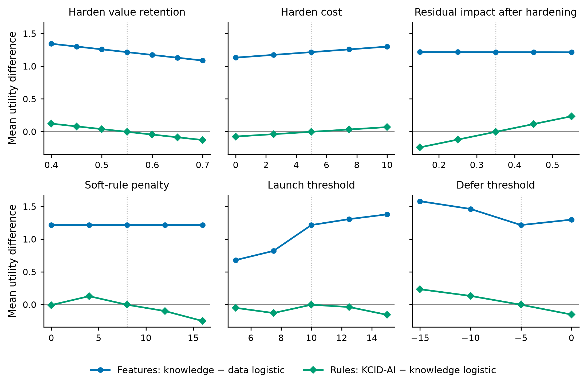

# Supplementary material

A knowledge-based AI decision-support system for cybersecurity-aware digital transformation screening using innovation and entrepreneurship indicators

**Table S1.** Descriptive statistics of the simulated population (N = 5,000).

| Indicator | Feature set | Mean (SD) | Correlation with breach |
|---|---|---:|---:|
| Innovation intensity | Opportunity | 0.503 (0.189) | −0.002 |
| Entrepreneurship orientation | Opportunity | 0.494 (0.182) | 0.019 |
| Data volume | Opportunity | 0.497 (0.193) | 0.208 |
| Data sensitivity | Opportunity | 0.498 (0.202) | 0.282 |
| Digital-transformation breadth | Opportunity | 0.502 (0.205) | 0.073 |
| Access control | Cybersecurity | 0.499 (0.207) | −0.240 |
| Encryption | Cybersecurity | 0.497 (0.183) | −0.228 |
| Monitoring | Cybersecurity | 0.498 (0.194) | −0.214 |
| Incident response | Cybersecurity | 0.499 (0.177) | −0.224 |
| Security skills | Cybersecurity | 0.501 (0.152) | −0.180 |
| Vendor control | Cybersecurity | 0.499 (0.161) | −0.209 |

*Note.* Pearson (point-biserial) correlations with the binary breach label; all indicators lie on [0, 1]. Values are produced by `code/analysis_published.py` (seed 23).

## Supplementary Note S1. Payoff and policy sensitivity

Fig. S1 varies the payoff and policy constants on the seed-23 fits. The feature effect stays between 0.68 and 1.58 across all 26 settings, and KCID-AI exceeds the opportunity logistic model in all of them (0.63 to 1.81). The rules' utility effect ranges from −0.25 to 0.23: it is positive when hardening is relatively unattractive (retention ≤ 0.50, cost ≥ 7.5, residual impact ≥ 0.45), at defer thresholds of −10 or −15 and at a penalty of 4, and negative otherwise. The rules' reduction in launched breaches grows with the soft penalty, from 0 at a penalty of 0 to −0.042 at 16. At a penalty of 0 only the hard rules act, and they leave launched breaches unchanged, so the reduction comes from the soft penalties. Across the same settings, the expected-utility policy has higher utility than KCID-AI in every case (by 0.03 to 2.57), but whether it launches more breaches depends on the payoffs. It launches fewer in 9 settings: every setting in which hardening is made more attractive (retention ≥ 0.60, cost ≤ 2.5, residual impact ≤ 0.25), and launch thresholds of 5 and 7.5, at which KCID-AI itself launches more. On the seed-23 fits, KCID-AI exceeds boosting with rules in utility in all 26 settings (0.05 to 0.99), an advantage that Table 2 of the main text shows to be seed-specific. Where the breach budget binds, the capped policy matches KCID-AI's launched breaches to within 0.016 and has higher utility except in 6 settings in which hardening is unattractive or the defer threshold is low, where KCID-AI is ahead by at most 0.21. Where hardening is attractive, the uncapped policy already launches fewer breaches than KCID-AI and the budget does not bind. KCID-AI exceeds the rule-only policy in utility (by 1.48 to 2.34) and launched breaches in every setting. The hybrid tracks the capped policy within 0.025 except at retention ≥ 0.65, a harden cost of 0 and residual impact ≤ 0.25, where forcing deferral instead of hardening costs it 0.06 to 0.73.

**Fig. S1.** One-at-a-time sensitivity of the mean utility differences to the payoff and policy constants (seed-23 fits). Blue: the feature effect (knowledge logistic − opportunity logistic). Green: the rule effect (KCID-AI − knowledge logistic). Dotted vertical lines mark the base values used in Sections 4.1–4.3 of the main text. The figure is drawn from the payoff rows in `results_original/sensitivity_results.json`.
