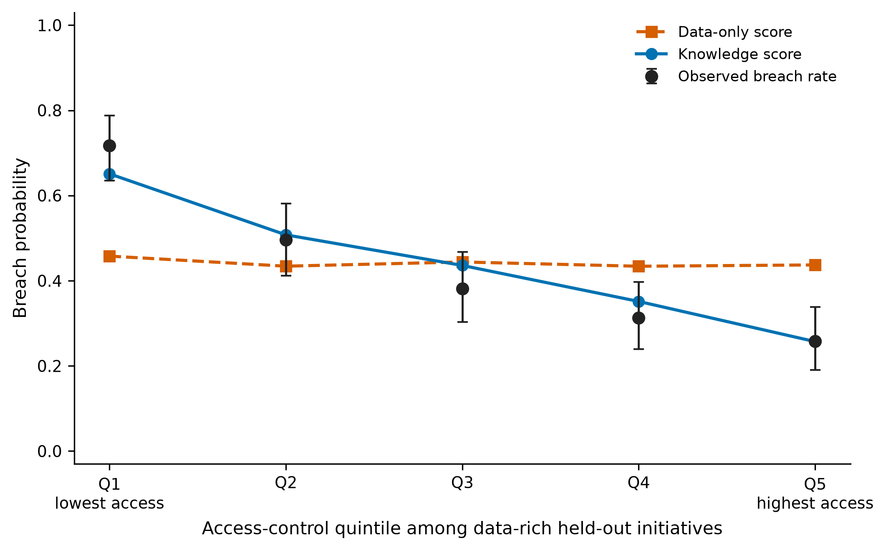

# A knowledge-based AI decision-support system for cybersecurity-aware digital transformation screening using innovation and entrepreneurship indicators

________________________^a,∗^

^a^ ________________________ (affiliation, city, country)

∗ Corresponding author. E-mail: ________________________

## Abstract

Digital transformation initiatives are often screened on innovation, entrepreneurship and data indicators, which describe opportunity but not whether cybersecurity controls can protect the data an initiative concentrates. This study asks whether cybersecurity indicators and explicit control rules contribute separately to that screening decision. KCID-AI combines a logistic breach-probability model with a propositional rule layer of hard exclusions and soft penalties to recommend launch, harden or defer. Lacking public breach-linked data, the evaluation uses a reproducible synthetic population of 5,000 initiatives (held-out: 1,251 initiatives, 448 breaches), a 2 × 2 factorial design and 50 regenerated populations. KCID-AI launches 170 breach-labelled initiatives, compared with 198 for logistic regression on opportunity indicators alone, and raises mean decision utility by 1.21 (95% bootstrap interval 0.25 to 2.19); the cybersecurity indicators account for this gain in every replication. The rules reduce launched breaches in every replication but do not raise utility, and a rule-only policy is dominated on both criteria. However, an expected-utility policy capped at KCID-AI's expected-breach budget launches almost the same number of breaches with higher utility in 46 of 50 replications. A hybrid that keeps KCID-AI's hard rules and explanations but sets launches by that policy matches its utility, yet in every replication explains fewer non-launch decisions and launches more initiatives with a flagged control gap. The rule layer therefore buys rule-consistent decisions, not a better utility–risk trade-off. The results hold under stated simulation assumptions; they do not establish real-world breach reduction or economic returns.

**Keywords:** Knowledge-based systems; Decision support; Cybersecurity; Digital transformation; Innovation; Entrepreneurship; Explainable artificial intelligence

## 1. Introduction

Digital transformation changes products, processes and business models [1–3], and recent reviews describe it as a multi-stage, organisation-wide change rather than a single technology adoption [4,5]. Digital technologies also reshape how ventures are formed and scaled [6–8] and how innovation itself is managed [9]. Adoption depends on organisational capabilities [10], digital technology use does not by itself raise innovation performance [11], and transformation affects firm performance through innovation [12]. Screening tools therefore rely on innovation, entrepreneurship and data indicators.

Those indicators describe opportunity, not whether an organisation can secure the data a new initiative concentrates. Cybersecurity extends information security to the protection of people, assets and interests that depend on digital systems [13], and transformation programmes enlarge the attack surface that must be managed [14]. Many incidents arise from human and organisational factors that technical investment alone does not address [15]. Losses are heavy-tailed and difficult to estimate because reliable incident-level data are scarce [16]. Security investment is classically framed as a trade-off between protection cost and expected loss [17], and decision-support methods have been proposed for allocating security resources [18]. Risk-assessment methods are usually specified for particular system classes, not portfolio screening [19]. The NIST Cybersecurity Framework 2.0 describes high-level outcomes and deliberately does not prescribe numeric thresholds [20].

Machine learning in cybersecurity has concentrated on detection tasks such as intrusion and malware detection [21,22], and its public benchmark data are mostly network-level traffic records [23]. Explainability has become a central requirement for security applications [24,25] and for responsible AI more generally [26]. Knowledge-based and expert systems encode domain rules that are directly readable [27], and informed machine learning integrates such prior knowledge into learning pipelines [28]. Hybrid systems that combine a rule-based expert component with a learned policy have been proposed for other decision domains [29]. In credit and churn modelling, interpretable logistic models remain the operational benchmark against tree ensembles [30,31], and evaluation increasingly uses decision value rather than accuracy alone [32].

The research gap addressed here lies between these streams. Initiative-level transformation screening rarely combines opportunity indicators with cybersecurity-control knowledge in a single launch, harden or defer decision, and existing hybrid designs seldom separate two different mechanisms: information added to a probability model, and explicit constraints applied to the resulting action. This paper asks whether cybersecurity indicators and explicit control rules change screening outcomes through distinct mechanisms. Its contributions are (i) KCID-AI, a decision-support system that keeps a logistic risk score and a propositional rule layer as separately switchable components; (ii) a 2 × 2 factorial evaluation that attributes utility and launched-breach changes to features or rules, benchmarked against gradient boosting with and without the same rules, a rule-only policy, direct expected-utility policies with and without a breach budget, and a hybrid of rules and budgeted expected utility; and (iii) a fully reproducible synthetic benchmark with replication across 50 regenerated populations and one-at-a-time sensitivity analysis of the payoff, penalty and threshold assumptions. Synthetic data are used because breach data linked to initiative indicators are not publicly available [16,23], and a controlled generator makes the ground truth known [33]. The contribution is therefore a transparent component comparison, not a new learning algorithm or a demonstrated improvement over deployed enterprise systems.

## 2. Methodology

### 2.1 Indicators and screening policy

Each initiative *i* has eleven indicators on [0, 1]. Five opportunity indicators measure innovation intensity (*x*~inn~), entrepreneurship orientation (*x*~ent~), data volume (*x*~vol~), data sensitivity (*x*~sens~) and digital-transformation breadth (*x*~dt~). Six cybersecurity indicators measure access control, encryption, monitoring, incident response, security skills and vendor control. Opportunity value *V* and breach impact *I*, both in illustrative utility units, are fixed before any model is fitted:

*I* = 25 + 90 *x*~sens~ + 40 *x*~vol~ + 20 *x*~dt~, (1)

*V* = 18 + 35 *x*~inn~ + 22 *x*~ent~ + 12 *x*~dt~. (2)

For a predicted breach probability *p* and a cumulative soft-rule penalty *P*, the screening score is

*J* = *V* − *pI* − *P*. (3)

Unless a hard rule fires, the action is launch if *J* ≥ 10, harden if −5 ≤ *J* < 10, and defer if *J* < −5. *P* = 0 when the rule layer is disabled, and a triggered hard rule overrides the thresholds and forces deferral. These thresholds are specified policy parameters, not estimates from a business population.

For evaluation, let *y* = 1 denote a simulated breach. Realised payoffs are *V* − *yI* for launch, 0.55*V* − 5 − 0.35*yI* for harden, and 0 for defer. The hardening retention (55%), cost (5) and residual impact (35%) are assumptions; no intervention experiment supports them, and the fixed thresholds in Eq. (3) are heuristic rather than payoff-maximising.

### 2.2 Knowledge-rule layer

The rule base is propositional and evaluated by forward chaining on each initiative. Three hard rules force deferral: r1, *x*~sens~ > 0.70 and access control < 0.45; r2, *x*~sens~ > 0.82 and encryption < 0.40; r3, *x*~vol~ > 0.72, monitoring < 0.38 and *x*~sens~ > 0.50. Four soft rules each add 8 units to *P*, and penalties accumulate: r4, *x*~vol~ > 0.65 and monitoring < 0.42; r5, *x*~dt~ > 0.60 and incident response < 0.40; r6, *x*~ent~ > 0.70, skills < 0.45 and *x*~sens~ > 0.50; r7, *x*~sens~ > 0.60 and vendor control < 0.40.

The thresholds are study assumptions, fixed before any test metric was computed; they are not NIST-validated values [20]. Hard rules fire on 9.3% of the simulated population. The predicates of r1–r5 and r7 do not appear explicitly in the breach equation (Section 3), but the generator uses related indicators, so the rules are not statistically independent of the outcome. Rule r6 repeats the venture-gap cutoffs of the breach process and is therefore partly aligned with the benchmark by construction.

### 2.3 Models and component comparisons

The probability model is L2-penalised logistic regression (*C* = 1) after standardisation on the training sample [34]. The opportunity model uses the five opportunity indicators; the knowledge model adds the six cybersecurity indicators. Crossing the two feature sets with rules off or on yields four policies; KCID-AI is the knowledge model with rules on. Rules change actions, not predicted probabilities, so the area under the receiver operating characteristic curve (AUROC) is identical within a feature set. Two gradient-boosting classifiers [35], one per feature set, use 250 trees, learning rate 0.05, maximum depth 3 and subsample fraction 0.85, without rules. All six policies use Eq. (3) with identical thresholds.

Six further policies test whether the rule layer adds anything beyond a flexible learner, a payoff-optimal policy or the rules alone, and whether rules and efficiency can be combined. Knowledge boosting with rules applies the same hard and soft rules to the knowledge-feature boosting probabilities. The direct expected-utility (EU) policy uses the knowledge logistic probability *p* and selects the action with the highest expected evaluation payoff,

*a*\* = argmax {*V* − *pI*, 0.55*V* − 5 − 0.35*pI*, 0} over launch, harden and defer, (4)

so it needs no thresholds. The EU policy with hard rules additionally forces deferral whenever r1–r3 fire. The capped EU policy prices each expected launched breach at λ ≥ 0, replacing the launch payoff by *V* − *pI* − λ*p*, and sets λ by bisection to the smallest value at which the expected number of launched breaches, the sum of *p* over launched initiatives, does not exceed that of KCID-AI on the same portfolio; it uses predicted probabilities only, never outcomes. The rule-only policy uses no probability model: it defers when a hard rule fires, hardens when any soft rule fires, and launches otherwise. The hybrid keeps KCID-AI's knowledge base but changes how it acts: hard rules force deferral, and the capped EU policy sets the remaining actions within the same budget; soft rules no longer change actions but are reported as named control flags. Two explanation measures apply to every policy: reason coverage, the share of non-launched initiatives for which at least one rule fires, and the flagged-launch share, the share of launches made while a soft rule flags a control gap. The analysis uses Python with scikit-learn 1.9.1 [36,37], NumPy 2.5.4, pandas 3.1.0 and matplotlib 3.11.2.

## 3. Simulation and evaluation design

Seed 23 generates 5,000 initiatives from four independent standard-normal latent factors for innovation, entrepreneurship, data intensity and control maturity; breadth also loads on innovation and data. Indicators are logistic transforms of these factors plus noise. The latent breach log-odds increase with sensitivity, volume, breadth and entrepreneurship, with three control-gap terms (sensitivity minus access, volume minus monitoring, and an encryption gap at high sensitivity) and with the venture-gap indicator, and decrease slightly with access and monitoring. The intercept is calibrated by bisection so that the mean latent probability is 0.36; realised prevalence is 0.358. All coefficients are listed in the public `analysis.py`.

A stratified split gives 3,749 training and 1,251 test initiatives (448 test breaches). Fitting and standardisation use training data only. The subgroup is defined from training-sample quantiles before any test metric is computed: data volume at or above the training median (0.493) and access control at or below the training 40th percentile (0.435). It contains 256 test initiatives and 156 breaches; it was not externally pre-registered.

Outcomes are AUROC, launched breaches (breaches assigned to launch), breach prevalence among launches, and mean realised utility. Paired bootstrap intervals use 1,000 resamples of the test set (seed 24); they describe uncertainty conditional on this population and these fitted models, not variability across generator settings, training samples or organisations. Binomial intervals in Fig. 1 are Wilson score intervals [38].

Two sensitivity analyses address the dependence on a single population and on author-chosen constants. First, the entire pipeline (population, split, subgroup cutoffs, model fits and evaluation) is regenerated for seeds 1 to 50, with the boosting random state set to the same seed; seed 23 reproduces the reported run exactly. Results are summarised by means, 2.5th–97.5th percentiles and sign counts across replications. Second, on the seed-23 fits, one parameter at a time is varied around its base value: harden value retention (0.40–0.70; base 0.55), harden cost (0–10; base 5), residual impact after hardening (0.15–0.55; base 0.35), soft-rule penalty (0–16; base 8), launch threshold (5–15; base 10) and defer threshold (−15 to 0; base −5), giving 26 distinct settings. The first three change only the evaluation payoff (and the actions of the expected-utility policies); the last three change the threshold policies' actions.

## 4. Results

### 4.1 Indicator structure and risk gradient

Supplementary Table S1 reports the means, standard deviations and breach correlations of the eleven simulated indicators. Innovation and entrepreneurship have near-zero correlations with breach (−0.002 and 0.019), data volume and sensitivity have positive correlations (0.208 and 0.282), and all six cybersecurity indicators have negative correlations (−0.180 to −0.240). These are associations built into the generator, not estimated effects of real controls.

Fig. 1 shows why opportunity indicators cannot stand in for control knowledge. Among the 656 data-rich test initiatives, breach prevalence falls from 94/131 = 0.718 in the lowest access-control quintile (95% Wilson interval 0.635–0.788) to 34/132 = 0.258 in the highest (0.191–0.338). Mean opportunity-model probabilities stay between 0.434 and 0.458, whereas knowledge-model probabilities fall from 0.651 to 0.257, tracking the observed gradient.

**Fig. 1.** Observed breach prevalence and mean predicted probabilities by access-control quintile among 656 data-rich test initiatives (quintile sizes 131, 131, 131, 131 and 132). Points show observed rates with 95% Wilson intervals; the dashed line shows the opportunity (data-only) logistic model and the solid line the knowledge logistic model.

### 4.2 Feature and rule contributions

Table 1 separates the feature and rule contributions. KCID-AI and the opportunity logistic model launch similar shares of initiatives (60.6% and 60.9%), but launched breaches fall from 198/448 to 170/448, a paired difference in the launched-breach rate of −0.062 (95% interval −0.102 to −0.024). Mean utility rises from 20.05 to 21.26, a difference of 1.21 (0.25 to 2.19). In the subgroup, launched breaches fall from 43/156 to 13/156 (−0.192; −0.257 to −0.131), and breach prevalence among subgroup launches falls from 43/98 to 13/43.

**Table 1.** Held-out screening results (n = 1,251; 448 breaches).

| Policy | Features | Rules | AUROC | Launched breaches | Breach prevalence among launches | Mean utility | Subgroup launched breaches |
|---|---|---|---:|---:|---:|---:|---:|
| Opportunity logistic | Opportunity | Off | 0.691 | 198/448 | 0.260 | 20.05 | 43/156 |
| Opportunity boosting | Opportunity | Off | 0.677 | 227/448 | 0.275 | 19.65 | 52/156 |
| Knowledge logistic | Opportunity + cybersecurity | Off | 0.728 | 180/448 | 0.232 | 21.27 | 21/156 |
| Knowledge boosting | Opportunity + cybersecurity | Off | 0.714 | 211/448 | 0.251 | 20.83 | 23/156 |
| Opportunity logistic + rules | Opportunity | On | 0.691 | 180/448 | 0.247 | 20.27 | 33/156 |
| KCID-AI | Opportunity + cybersecurity | On | 0.728 | 170/448 | 0.224 | 21.26 | 13/156 |
| Knowledge boosting + rules | Opportunity + cybersecurity | On | 0.714 | 205/448 | 0.248 | 20.74 | 19/156 |
| Expected-utility | Opportunity + cybersecurity | Off | 0.728 | 184/448 | 0.230 | 21.81 | 22/156 |
| Expected-utility + hard rules | Opportunity + cybersecurity | Hard only | 0.728 | 184/448 | 0.230 | 21.82 | 22/156 |
| Expected-utility, capped | Opportunity + cybersecurity | Off | 0.728 | 172/448 | 0.226 | 21.56 | 16/156 |
| Rule-only | Cybersecurity rules only | On | — | 265/448 | 0.275 | 19.36 | 25/156 |
| Hybrid (hard rules + capped expected-utility) | Opportunity + cybersecurity | Hard only | 0.728 | 172/448 | 0.226 | 21.56 | 16/156 |

*Note.* Subgroup: 256 test initiatives (156 breaches) with data volume ≥ 0.493 and access control ≤ 0.435. Launched-breach counts use all breaches as the denominator; prevalence among launches uses launches as the denominator. Rules leave AUROC unchanged. The last six rows are the additional policies of Section 2.3; the expected-utility policies use the knowledge logistic probabilities and Eq. (4) instead of thresholds, and the rule-only policy has no probability model. Utility is in illustrative units.

With rules off, adding the cybersecurity indicators raises mean utility by 1.22 (0.30 to 2.14) and lowers the launched-breach rate by 0.040 (−0.078 to −0.004). Adding the rules to the knowledge model then reduces launched breaches from 180 to 170, a rate difference of −0.022 (−0.037 to −0.011), and subgroup launched breaches from 21 to 13 (exact difference −8/156 = −0.051; bootstrap interval −0.089 to −0.020). The corresponding utility change is −0.006 (−0.28 to 0.25), which establishes neither equivalence nor improvement. Rules on the opportunity model also reach 180 launched breaches, at a lower point-estimate utility (20.27; not bootstrapped).

Relative to knowledge boosting (211 launched breaches, utility 20.83), KCID-AI shows a utility difference of 0.43 (−0.29 to 1.23) and a subgroup difference of −0.064 (−0.108 to −0.021). Adding the rules to boosting reduces its launched breaches from 211 to 205 (−0.013; −0.024 to −0.004) with a utility change of −0.09 (−0.35 to 0.16); KCID-AI still launches fewer (−0.078; −0.106 to −0.049). The expected-utility policy attains the highest utility in Table 1 (21.81) but launches 184 breaches; relative to it, KCID-AI loses 0.55 utility (−1.06 to −0.04) and launches fewer breaches overall (−0.031; −0.049 to −0.013) and in the subgroup (−0.058; −0.096 to −0.027). Adding the hard rules to the expected-utility policy changes no launch, because it already declines to launch the initiatives they exclude. Given the same expected-breach budget as KCID-AI, the capped policy launches 172 breaches, 16 in the subgroup, with utility 21.56; its differences from KCID-AI include zero for utility (−0.30; −0.77 to 0.19), launched breaches (−0.004; −0.020 to 0.012) and the subgroup (−0.019; −0.056 to 0.014). The rule-only policy launches 77% of initiatives, including 265 breaches, with utility 19.36; KCID-AI improves on it in utility (1.90; 0.52 to 3.30) and launched breaches (−0.212; −0.258 to −0.165). The hybrid launches exactly the same initiatives as the capped policy; its hard rules only move 17 initiatives from harden to defer. Its explanations are weaker than KCID-AI's: 47.3% of the initiatives it does not launch carry a named rule, against 49.3% for KCID-AI (difference 0.020; 0.009 to 0.033), and 7.4% of its launches carry a soft-rule flag, against 5.9% (−0.014; −0.023 to −0.007).

### 4.3 Where the launches move

Fig. 2 locates the changes. In the lowest access quintile (94 breaches), the opportunity logistic model, knowledge logistic model and KCID-AI launch 0.287, 0.096 and 0.043 of breach-labelled initiatives. In the highest quintile (34 breaches), the corresponding shares are 0.382, 0.676 and 0.676. Launches thus move from high-risk, low-access initiatives towards high-access ones. The rules bind only in the low-access quintiles, where KCID-AI separates from the knowledge model.

**Fig. 2.** Share of breach-labelled initiatives that each policy launches, within the access-control quintiles of Fig. 1 (breach counts 94, 65, 50, 41 and 34). The knowledge logistic model and KCID-AI coincide from Q3 upward. Points are estimates without uncertainty intervals.

### 4.4 Robustness to the seed and to payoff and policy assumptions

Table 2 summarises 50 regenerated populations. The feature effect replicates without exception: adding the cybersecurity indicators raises mean utility in all 50 replications (paired mean 1.80; 2.5th–97.5th percentile 0.99 to 2.60), and KCID-AI exceeds the opportunity logistic model in all 50 (mean 1.62). The rule layer lowers the launched-breach rate relative to the knowledge logistic model in all 50 replications (mean −0.020) and lowers subgroup launched breaches in 48, with no change in the other two, but its utility effect is negative in 44 of 50 (mean −0.18; −0.41 to 0.09). The same pattern holds when the rules are added to boosting: launched breaches fall in all 50 replications (mean −0.021) and utility falls in 40 (mean −0.10). Against every comparator, KCID-AI launches fewer breaches in all 50 replications, but it has the higher utility consistently only against the opportunity logistic model. The expected-utility policy has the highest mean utility, exceeding KCID-AI in 49 of 50 replications by a mean of 0.48 (0.10 to 0.82), while launching more breaches (mean difference 0.038). Adding hard rules to that policy changes launched breaches in only 5 replications and leaves utility essentially unchanged (mean −0.006). KCID-AI's seed-23 utility advantages over boosting do not generalise. At an equal expected-breach budget, the capped expected-utility policy launches almost exactly as many breaches as KCID-AI (mean difference −0.002) but has higher utility in 46 of 50 replications (mean 0.29; 2.5th–97.5th percentile −0.17 to 0.65); capping costs the uncapped policy 0.20 utility units on average while removing 0.036 of launched breaches. The rule-only policy is dominated: KCID-AI has higher utility and fewer launched breaches in all 50 replications (mean differences 1.72 and −0.204). The hybrid inherits the capped policy's efficiency: it has higher utility than KCID-AI in 46 of 50 replications (mean 0.28) with almost the same launched breaches, and differs from the capped policy by less than 0.01 in mean utility. It does not inherit KCID-AI's rule consistency: in all 50 replications, KCID-AI has higher reason coverage (mean 0.498 against 0.479) and a lower flagged-launch share (0.058 against 0.073).

**Table 2.** Policy outcomes across 50 regenerated populations (seeds 1–50).

| Policy | Mean utility | Launched-breach rate | Subgroup launched-breach rate | Replications with higher KCID-AI utility | Replications with fewer KCID-AI launched breaches |
|---|---:|---:|---:|---:|---:|
| Opportunity logistic | 19.20 (18.02–20.94) | 0.454 (0.407–0.510) | 0.261 (0.194–0.337) | 50/50 | 50/50 |
| Knowledge logistic | 21.00 (19.81–22.95) | 0.406 (0.359–0.451) | 0.111 (0.056–0.191) | 6/50 | 50/50 |
| Knowledge boosting | 21.13 (19.70–22.98) | 0.463 (0.402–0.502) | 0.140 (0.082–0.223) | 8/50 | 50/50 |
| Knowledge boosting + rules | 21.04 (19.75–22.66) | 0.442 (0.383–0.484) | 0.114 (0.065–0.181) | 15/50 | 50/50 |
| Expected-utility | 21.30 (20.14–23.25) | 0.424 (0.375–0.465) | 0.118 (0.065–0.211) | 1/50 | 50/50 |
| Expected-utility + hard rules | 21.29 (20.16–23.23) | 0.423 (0.375–0.465) | 0.118 (0.065–0.211) | 1/50 | 50/50 |
| Expected-utility, capped | 21.11 (19.82–22.96) | 0.388 (0.343–0.428) | 0.093 (0.044–0.179) | 4/50 | 30/50 |
| Rule-only | 19.10 (17.52–20.70) | 0.590 (0.543–0.629) | 0.210 (0.147–0.280) | 50/50 | 50/50 |
| Hybrid | 21.10 (19.85–22.95) | 0.388 (0.343–0.428) | 0.093 (0.044–0.179) | 4/50 | 30/50 |
| KCID-AI | 20.82 (19.66–22.66) | 0.386 (0.341–0.433) | 0.087 (0.039–0.152) | — | — |

*Note.* Means across replications, with 2.5th–97.5th percentiles in parentheses. The last two columns count replications in which the paired difference between KCID-AI and the row policy favours KCID-AI; against the capped policy and the hybrid, KCID-AI launches more breaches in 15 and 16 replications and the same number in 5 and 4. Each replication regenerates the population, split, subgroup cutoffs and fits. Values are produced by `sensitivity.py`.

Supplementary Note S1 and Fig. S1 vary the payoff and policy constants on the seed-23 fits. The feature effect is positive in all 26 settings (0.68 to 1.58), the rules' utility effect changes sign (−0.25 to 0.23), and the soft penalties, not the hard exclusions, drive the rule-based reduction in launched breaches. The capped and hybrid policies have higher utility than KCID-AI in 20 of the 26 settings; where hardening is attractive, the uncapped expected-utility policy already launches fewer breaches than KCID-AI.

## 5. Discussion and limitations

The results separate two mechanisms that hybrid knowledge-based designs often combine [28,29]. Cybersecurity information in the score accounts for the utility gain in every replication and payoff setting examined, consistent with the economic view that security value comes from better-targeted expected-loss estimates [17,18]. The rules consistently remove further breach-labelled launches where control gaps are most severe, but their utility effect is small, usually slightly negative and sign-dependent on the payoffs. They act as a readable risk-appetite instrument that caps unsafe launches and explains deferrals, although, as the baselines show, not the most efficient one. Keeping risk estimation and organisational restrictions as distinct components meets explainability requirements for security decisions [24–26]: a rule that forces deferral states its reason, whereas a probability shift does not.

The added baselines sharpen this reading. The expected-utility policy attains the highest utility in almost every replication, as expected; the fixed thresholds of Eq. (3) are not utility-optimal, because the expected launch–harden payoff difference, 0.45*V* + 5 − 0.65*pI*, is not a function of *J* alone. Given the same expected-breach budget, a payoff-optimising policy launches almost the same number of breaches and recovers most of the utility, so KCID-AI does not lie on the efficient utility–risk frontier in this population. Its remaining advantages are rule consistency and simplicity: its decisions agree more often with the named control conditions, and the policy can be stated and audited without estimating payoffs or a shadow price. The rule-only policy, by contrast, is dominated, so the probability model is indispensable and the rules are useful only as its complement. Boosting, with or without the rules, launches more breaches than KCID-AI in every replication, consistent with evidence that interpretable logistic models remain competitive with tree ensembles [30,31]. The hybrid reaches the capped policy's utility, but because its hard rules rarely bind and its soft rules no longer act, it launches more initiatives with a named, unresolved control gap. Choosing between KCID-AI and the hybrid is therefore a governance decision, whether a soft-rule flag may stand on a launched initiative, priced here at about 0.3 utility units per initiative; profit-based evaluation offers a principled way to make it [32].

Several limitations remain. The replications vary the random draws, not the generator's structure; Rule r6 overlaps the generator and the other rules share related inputs. The payoff and policy constants were varied one at a time on a single population, not jointly. The expected-utility policies are favoured by construction because they optimise the payoffs used for evaluation, and the capped policy's budget is taken from KCID-AI itself. Calibration was not assessed, and no real incident data were used; such data remain difficult to obtain [16,23].

## 6. Conclusion

KCID-AI separates learned cybersecurity information from explicit screening constraints in a synthetic study of digital transformation screening. Cybersecurity indicators account for the utility gain across all 50 regenerated populations and payoff settings. The rules reduce launched breaches in every replication but do not raise expected utility, and rules without a probability model are dominated. An expected-utility policy given the same expected-breach budget, alone or combined with KCID-AI's hard rules and explanations, matches KCID-AI's launched breaches with higher utility in 46 of 50 replications, but launches more initiatives that carry a flagged control gap. KCID-AI's contribution is therefore rule-consistent, auditable screening at a modest utility cost, rather than a more efficient trade-off. Future work should calibrate the rules against NIST-aligned organisational assessments [20], use incident-cost evidence for the payoffs [16], vary the generator and constants jointly, and test with decision makers whether rule consistency justifies its utility cost before any claim about enterprise deployment.

## CRediT authorship contribution statement

________________________: Conceptualization, Methodology, Software, Validation, Formal analysis, Investigation, Data curation, Writing – original draft, Writing – review & editing, Visualization.

## Declaration of competing interest

The author declares that there are no known competing financial interests or personal relationships that could have appeared to influence the work reported in this paper.

## Funding

This research did not receive any specific grant from funding agencies in the public, commercial, or not-for-profit sectors.

## Data availability

The synthetic data are generated by `analysis.py` (seed 23), which also produces Table 1, Supplementary Table S1, Figs. 1–2 and `results.json`; `sensitivity.py` produces Table 2, Supplementary Fig. S1 and `sensitivity_results.json`. The code and outputs are publicly available at https://github.com/saisowmithrepalamo/kb-ai-dt-readiness (folder `kcid-kbs`). No human-participant data or real enterprise breach records were used.

## Declaration of generative AI and AI-assisted technologies in the manuscript preparation process

During the preparation of this work the author used Cursor, ChatGPT (OpenAI) and Claude (Anthropic) to assist with drafting language, organising analysis code, formatting, and checking reference metadata. After using these tools, the author reviewed and edited the content as needed and takes full responsibility for the content of the published article.

## References

[1] G. Vial, Understanding digital transformation: A review and a research agenda, J. Strateg. Inf. Syst. 28 (2019) 118–144. https://doi.org/10.1016/j.jsis.2019.01.003.

[2] S. Nambisan, Digital entrepreneurship: Toward a digital technology perspective of entrepreneurship, Entrep. Theory Pract. 41 (2017) 1029–1055. https://doi.org/10.1111/etap.12254.

[3] A. Bharadwaj, O.A. El Sawy, P.A. Pavlou, N. Venkatraman, Digital business strategy: Toward a next generation of insights, MIS Q. 37 (2013) 471–482. https://doi.org/10.25300/MISQ/2013/37:2.3.

[4] P.C. Verhoef, T. Broekhuizen, Y. Bart, A. Bhattacharya, J.Q. Dong, N. Fabian, M. Haenlein, Digital transformation: A multidisciplinary reflection and research agenda, J. Bus. Res. 122 (2021) 889–901. https://doi.org/10.1016/j.jbusres.2019.09.022.

[5] S. Kraus, S. Durst, J.J. Ferreira, P. Veiga, N. Kailer, A. Weinmann, Digital transformation in business and management research: An overview of the current status quo, Int. J. Inf. Manage. 63 (2022) 102466. https://doi.org/10.1016/j.ijinfomgt.2021.102466.

[6] G. Elia, A. Margherita, G. Passiante, Digital entrepreneurship ecosystem: How digital technologies and collective intelligence are reshaping the entrepreneurial process, Technol. Forecast. Soc. Change 150 (2020) 119791. https://doi.org/10.1016/j.techfore.2019.119791.

[7] P.M. Bican, A. Brem, Digital business model, digital transformation, digital entrepreneurship: Is there a sustainable “digital”?, Sustainability 12 (2020) 5239. https://doi.org/10.3390/su12135239.

[8] L. Satalkina, G. Steiner, Digital entrepreneurship and its role in innovation systems: A systematic literature review as a basis for future research avenues for sustainable transitions, Sustainability 12 (2020) 2764. https://doi.org/10.3390/su12072764.

[9] A. Brem, F. Giones, M. Werle, The AI digital revolution in innovation: A conceptual framework of artificial intelligence technologies for the management of innovation, IEEE Trans. Eng. Manage. 70 (2023) 770–776. https://doi.org/10.1109/TEM.2021.3109983.

[10] N. Omrani, N. Rejeb, A. Maalaoui, M. Dabić, S. Kraus, Drivers of digital transformation in SMEs, IEEE Trans. Eng. Manage. 71 (2024) 5030–5043. https://doi.org/10.1109/TEM.2022.3215727.

[11] A. Usai, F. Fiano, A. Messeni Petruzzelli, P. Paoloni, M. Farina Briamonte, B. Orlando, Unveiling the impact of the adoption of digital technologies on firms’ innovation performance, J. Bus. Res. 133 (2021) 327–336. https://doi.org/10.1016/j.jbusres.2021.04.035.

[12] Y. Peng, C. Tao, Can digital transformation promote enterprise performance? —From the perspective of public policy and innovation, J. Innov. Knowl. 7 (2022) 100198. https://doi.org/10.1016/j.jik.2022.100198.

[13] R. von Solms, J. van Niekerk, From information security to cyber security, Comput. Secur. 38 (2013) 97–102. https://doi.org/10.1016/j.cose.2013.04.004.

[14] S. Saeed, S.A. Altamimi, N.A. Alkayyal, E. Alshehri, D.A. Alabbad, Digital transformation and cybersecurity challenges for businesses resilience: Issues and recommendations, Sensors 23 (2023) 6666. https://doi.org/10.3390/s23156666.

[15] K. Khando, S. Gao, S.M. Islam, A. Salman, Enhancing employees information security awareness in private and public organisations: A systematic literature review, Comput. Secur. 106 (2021) 102267. https://doi.org/10.1016/j.cose.2021.102267.

[16] M. Eling, J. Wirfs, What are the actual costs of cyber risk events?, Eur. J. Oper. Res. 272 (2019) 1109–1119. https://doi.org/10.1016/j.ejor.2018.07.021.

[17] L.A. Gordon, M.P. Loeb, The economics of information security investment, ACM Trans. Inf. Syst. Secur. 5 (2002) 438–457. https://doi.org/10.1145/581271.581274.

[18] A. Fielder, E. Panaousis, P. Malacaria, C. Hankin, F. Smeraldi, Decision support approaches for cyber security investment, Decis. Support Syst. 86 (2016) 13–23. https://doi.org/10.1016/j.dss.2016.02.012.

[19] Y. Cherdantseva, P. Burnap, A. Blyth, P. Eden, K. Jones, H. Soulsby, K. Stoddart, A review of cyber security risk assessment methods for SCADA systems, Comput. Secur. 56 (2016) 1–27. https://doi.org/10.1016/j.cose.2015.09.009.

[20] National Institute of Standards and Technology, The NIST Cybersecurity Framework (CSF) 2.0, NIST Cybersecurity White Paper (CSWP) 29, Gaithersburg, MD, 2024. https://doi.org/10.6028/NIST.CSWP.29.

[21] A.L. Buczak, E. Guven, A survey of data mining and machine learning methods for cyber security intrusion detection, IEEE Commun. Surv. Tutor. 18 (2016) 1153–1176. https://doi.org/10.1109/COMST.2015.2494502.

[22] Y. Xin, L. Kong, Z. Liu, Y. Chen, Y. Li, H. Zhu, M. Gao, H. Hou, C. Wang, Machine learning and deep learning methods for cybersecurity, IEEE Access 6 (2018) 35365–35381. https://doi.org/10.1109/ACCESS.2018.2836950.

[23] M. Ring, S. Wunderlich, D. Scheuring, D. Landes, A. Hotho, A survey of network-based intrusion detection data sets, Comput. Secur. 86 (2019) 147–167. https://doi.org/10.1016/j.cose.2019.06.005.

[24] N. Capuano, G. Fenza, V. Loia, C. Stanzione, Explainable artificial intelligence in cybersecurity: A survey, IEEE Access 10 (2022) 93575–93600. https://doi.org/10.1109/ACCESS.2022.3204171.

[25] Z. Zhang, H. Al Hamadi, E. Damiani, C.Y. Yeun, F. Taher, Explainable artificial intelligence applications in cyber security: State-of-the-art in research, IEEE Access 10 (2022) 93104–93139. https://doi.org/10.1109/ACCESS.2022.3204051.

[26] A. Barredo Arrieta, N. Díaz-Rodríguez, J. Del Ser, A. Bennetot, S. Tabik, A. Barbado, S. Garcia, S. Gil-Lopez, D. Molina, R. Benjamins, R. Chatila, F. Herrera, Explainable artificial intelligence (XAI): Concepts, taxonomies, opportunities and challenges toward responsible AI, Inf. Fusion 58 (2020) 82–115. https://doi.org/10.1016/j.inffus.2019.12.012.

[27] S.-H. Liao, Expert system methodologies and applications—a decade review from 1995 to 2004, Expert Syst. Appl. 28 (2005) 93–103. https://doi.org/10.1016/j.eswa.2004.08.003.

[28] L. von Rueden, S. Mayer, K. Beckh, B. Georgiev, S. Giesselbach, R. Heese, B. Kirsch, M. Walczak, J. Pfrommer, A. Pick, R. Ramamurthy, J. Garcke, C. Bauckhage, J. Schuecker, Informed machine learning – A taxonomy and survey of integrating prior knowledge into learning systems, IEEE Trans. Knowl. Data Eng. 35 (2023) 614–633. https://doi.org/10.1109/TKDE.2021.3079836.

[29] Y. Kwon, Z. Lee, A hybrid decision support system for adaptive trading strategies: Combining a rule-based expert system with a deep reinforcement learning strategy, Decis. Support Syst. 177 (2024) 114100. https://doi.org/10.1016/j.dss.2023.114100.

[30] E. Dumitrescu, S. Hué, C. Hurlin, S. Tokpavi, Machine learning for credit scoring: Improving logistic regression with non-linear decision-tree effects, Eur. J. Oper. Res. 297 (2022) 1178–1192. https://doi.org/10.1016/j.ejor.2021.06.053.

[31] A. De Caigny, K. Coussement, K.W. De Bock, A new hybrid classification algorithm for customer churn prediction based on logistic regression and decision trees, Eur. J. Oper. Res. 269 (2018) 760–772. https://doi.org/10.1016/j.ejor.2018.02.009.

[32] T. Verbraken, W. Verbeke, B. Baesens, A novel profit maximizing metric for measuring classification performance of customer churn prediction models, IEEE Trans. Knowl. Data Eng. 25 (2013) 961–973. https://doi.org/10.1109/TKDE.2012.50.

[33] H. Arian, D. Norouzi Mobarekeh, L. Seco, Backtest overfitting in the machine learning era: A comparison of out-of-sample testing methods in a synthetic controlled environment, Knowl.-Based Syst. 305 (2024) 112477. https://doi.org/10.1016/j.knosys.2024.112477.

[34] T. Hastie, R. Tibshirani, J. Friedman, The Elements of Statistical Learning, second ed., Springer, New York, 2009. https://doi.org/10.1007/978-0-387-84858-7.

[35] J.H. Friedman, Greedy function approximation: A gradient boosting machine, Ann. Stat. 29 (2001) 1189–1232. https://doi.org/10.1214/aos/1013203451.

[36] F. Pedregosa, G. Varoquaux, A. Gramfort, V. Michel, B. Thirion, O. Grisel, M. Blondel, P. Prettenhofer, R. Weiss, V. Dubourg, J. Vanderplas, A. Passos, D. Cournapeau, M. Brucher, M. Perrot, É. Duchesnay, Scikit-learn: Machine learning in Python, J. Mach. Learn. Res. 12 (2011) 2825–2830. https://jmlr.org/papers/v12/pedregosa11a.html.

[37] scikit-learn developers, scikit-learn, version 1.9.1 [software]. https://scikit-learn.org/stable/whats_new/v1.9.html (accessed 23 October 2026).

[38] E.B. Wilson, Probable inference, the law of succession, and statistical inference, J. Am. Stat. Assoc. 22 (1927) 209–212. https://doi.org/10.1080/01621459.1927.10502953.
