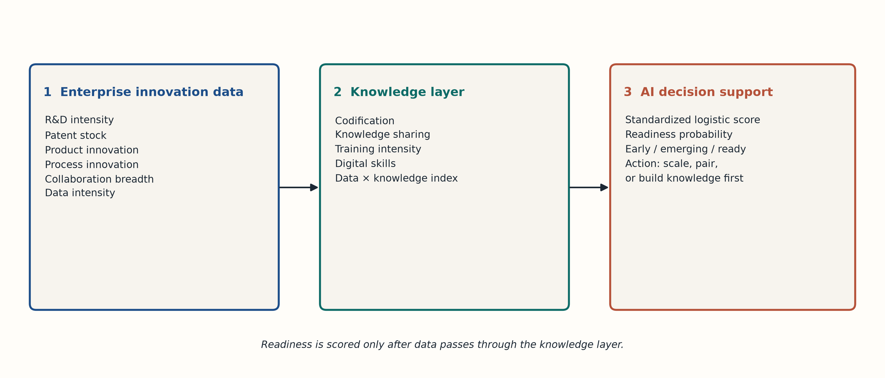
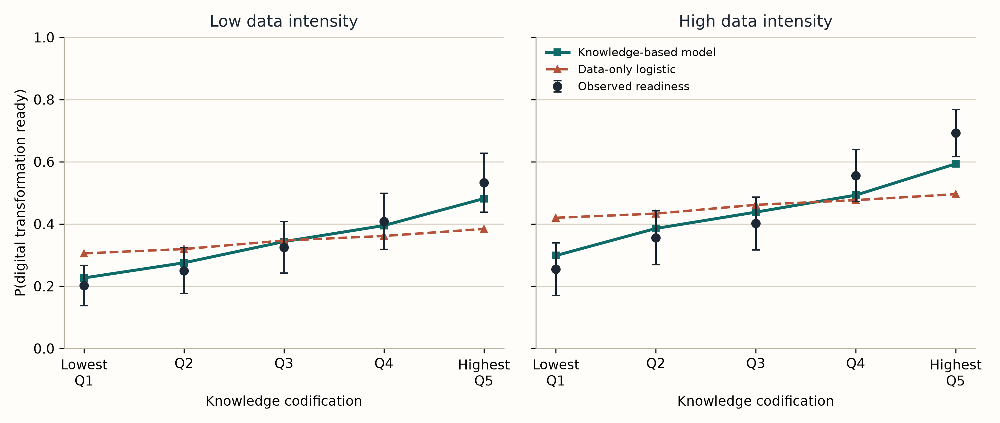

# A knowledge-based AI decision-support model for predicting digital transformation readiness from enterprise innovation data

**Target journal:** *Journal of Innovation & Knowledge* (short communication)

**Manuscript type:** Short communication. Prepared for double-anonymized review.

## Abstract

Firms that already spend on innovation and already collect large volumes of data still fail at digital transformation. This short communication specifies a knowledge-based artificial intelligence decision-support model that predicts digital transformation readiness from enterprise innovation data. The score separates an innovation index and data intensity from a knowledge index built on codification, sharing, training, and digital skills. No public enterprise file records these inputs together with a comparable readiness label, so the model is illustrated on a reproducible synthetic population of 5,000 enterprises. The data-generating process treats data as productive when knowledge is in place. On 1,250 held-out enterprises the knowledge-based score reaches an area under the curve of 0.671, compared with 0.620 for a logistic model and 0.605 for gradient boosting trained on innovation and data indicators alone. The paired difference versus the logistic model is 0.050 (95% bootstrap interval 0.022 to 0.077). The practical gain is sharper. Among data-rich, knowledge-poor enterprises, the false-positive rate falls from 0.120 and 0.180 to 0.038. A more flexible algorithm does not replace the knowledge layer. One command rebuilds both figures and both tables.

**Keywords:** Artificial intelligence; Data; Knowledge; Digital transformation; Innovation; Entrepreneurship

## 1. Introduction

Digital transformation is an innovation problem and a knowledge problem at the same time. Firms adopt platforms, sensors, and analytics in order to change products, processes, and business models, yet many of those investments never become a repeatable way of working (Hess, Matt, Benlian, & Wiesböck, 2016; Vial, 2019). The knowledge-based view locates the reason in the firm rather than in the tool. What the firm can do depends on the knowledge it can create, codify, and apply (Grant, 1996; Nonaka, 1994). Data are an input to that process. They are not a substitute for it.

Two research streams already point to the same mechanism. Absorptive capacity argues that outside knowledge, including knowledge carried by new digital systems, is useful only when people can recognize and exploit it (Cohen & Levinthal, 1990). Dynamic capabilities make the same point for digital transformation specifically: sensing and seizing a digital opportunity depends on learning routines, not on the volume of data a firm stores (Teece, 2007; Warner & Wäger, 2019). Entrepreneurship research reaches a parallel conclusion. Digital technologies change how opportunities are formed, but the venture still has to convert technical inputs into organizational knowledge (Nambisan, 2017).

The measurement practice of firms has not caught up with that argument. Readiness assessments and data-driven decision programs tend to score technology spending, data volume, and innovation outputs (Brynjolfsson & McElheran, 2016). Those indicators are available. Knowledge codification, knowledge sharing, training, and digital skills are collected less often, and they are rarely allowed to change the go or no-go decision. This short communication offers a decision-support score that keeps the innovation data managers already have and adds an explicit knowledge layer. The artificial intelligence component is deliberately small: a standardized logistic score that a manager can read, benchmarked against gradient boosting so that flexibility is not confused with explanation.

The illustration is synthetic, and the paper says so before any result. The contribution is the model and a fully specified demonstration of what changes when the knowledge layer is omitted. It is not an estimate for a named industry.

## 2. Decision-support model

Figure 1 is the whole architecture. Enterprise innovation data enter a knowledge layer, and only then a readiness score.

**Figure 1.** Knowledge-based AI decision-support architecture. The innovation block keeps the indicators firms already report. The knowledge layer converts those inputs into an index of codification, sharing, training, and skills. The decision score is a logistic probability with three actions: build knowledge first, pair data with knowledge, or scale.

The innovation block contains six indicators: R&D intensity, the log of the patent stock, product innovation, process innovation, collaboration breadth, and data intensity. The first five are collapsed into an innovation index. Data intensity stays separate, because the decision the model is built to inform is whether data, on their own, signal readiness.

The knowledge layer contains four process indicators: knowledge codification, knowledge sharing, training intensity, and digital skills. Their standardized average is the knowledge index. Codification and sharing represent the conversion of experience into something the firm can reuse (Nonaka, 1994). Training and digital skills represent absorptive capacity (Cohen & Levinthal, 1990).

Each indicator is standardized with the training-sample mean and standard deviation. The innovation index and the knowledge index are averages of those standardized items, and the indexes are then standardized once more. Data intensity is standardized in the same way. The linear predictor of the decision score is

η = β0 + βI I + βD D + βK K + βDK (D × K),

where I is the innovation index, D is data intensity, and K is the knowledge index. Readiness probability is the logistic transform, 1 / (1 + exp(−η)). D × K lets the value of data depend on knowledge. βD is the association of data with readiness when the knowledge index is at its training mean.

The score is a decision, not only a probability. Below 0.35 the recommended action is to build knowledge routines before any further spending on data platforms. From 0.35 to 0.60 the firm is emerging, and new data investment should be paired with codification and sharing. Above 0.60 the firm is scored as ready to scale the transformation. Classification metrics in this paper use a single threshold of 0.50 so that the three models are compared on the same rule.

Two benchmarks use only the six innovation and data indicators. The first is an L2-penalized logistic regression (C = 1) on standardized indicators. The second is gradient boosting with 250 trees, a learning rate of 0.05, a maximum depth of 3, and a subsample fraction of 0.85 (Friedman, 2001). Boosting can represent interactions among the six indicators if those interactions are present in the data. It cannot use knowledge-process measures it is not given. That is the comparison the paper needs: a flexible algorithm on innovation data, against a transparent score that includes knowledge.

## 3. Illustrative population

No public microdata set reports innovation inputs, knowledge-process measures, and a common digital-transformation readiness label. Inventing a survey would not solve that. The demonstration therefore uses a synthetic population of 5,000 enterprises, generated with seed 23. The structural equation is the hypothesis, written down so that a reader can see exactly what the model is being asked to recover.

Each enterprise has four latent factors: innovation effort, knowledge processes, data intensity, and skills. Cross-factor correlations are low, between 0.10 and 0.32, so that R&D, patents, and product innovation are weak stand-ins for knowledge routines. Observed indicators are noisy reflections of those factors. R&D intensity is a small share of sales. Patent stock is logged. The other indicators lie on the unit interval.

The readiness label is Bernoulli. On the latent scale,

η* = −2.316 + 0.55 Innovation + 1.35 Knowledge + 0.05 Data + 2.60 (Data × Knowledge) + 0.45 Skills + 0.12 ε,

with ε standard normal. The intercept is calibrated so that 40% of enterprises are ready. Data have almost no main effect. They raise readiness through knowledge. A shock remains, so the label is not a deterministic function of the indicators a model can see.

The sample is split 75/25, stratified on the label, into 3,750 training enterprises and 1,250 test enterprises. All standardization, the boosting fit, and the logistic fits use the training sample only. Performance is reported on the test sample. Uncertainty for the area under the curve is a percentile bootstrap with 1,000 resamples of the test enterprises. The same paired resamples are used for the difference between models.

One cell is defined in advance, because it is the cell in which a data-only score is most likely to give the wrong managerial instruction. A test enterprise is data-rich and knowledge-poor when its data intensity is at least the training median (0.502) and its knowledge codification is below 0.40. That cell contains 188 test enterprises, of whom 29.3% are actually ready.

The exact indicator equations, the factor correlation matrix, and the fitting code are in `analysis.py`. Running that file overwrites the figures, the tables, and `results.json`.

## 4. Results

Table 1 describes the full population. Knowledge-process indicators correlate more strongly with readiness than the innovation indicators do. Knowledge sharing (0.273) and knowledge codification (0.263) lead. Training intensity is 0.210. R&D intensity, patents, and product innovation are close to 0.11. Data intensity correlates at 0.142, the same order of magnitude as digital skills and well below codification. A firm that ranks itself as data-rich is not, on that fact alone, a firm that is ready.

**Table 1. Enterprise innovation and knowledge indicators (N = 5,000)**

| Indicator | Role | Mean | SD | P10 | P90 | Corr. with ready |
|---|---|---:|---:|---:|---:|---:|
| R&D intensity | Innovation and data | 0.105 | 0.037 | 0.054 | 0.155 | 0.105 |
| Patent stock (log) | Innovation and data | 1.347 | 0.532 | 0.630 | 2.063 | 0.110 |
| Product innovation | Innovation and data | 0.498 | 0.212 | 0.217 | 0.781 | 0.110 |
| Process innovation | Innovation and data | 0.499 | 0.194 | 0.242 | 0.756 | 0.118 |
| Collaboration breadth | Innovation and data | 0.500 | 0.190 | 0.253 | 0.755 | 0.151 |
| Data intensity | Innovation and data | 0.502 | 0.207 | 0.222 | 0.778 | 0.142 |
| Knowledge codification | Knowledge process | 0.503 | 0.205 | 0.229 | 0.777 | 0.263 |
| Knowledge sharing | Knowledge process | 0.503 | 0.195 | 0.242 | 0.765 | 0.273 |
| Training intensity | Knowledge process | 0.505 | 0.178 | 0.266 | 0.739 | 0.210 |
| Digital skills | Knowledge process | 0.504 | 0.207 | 0.226 | 0.782 | 0.142 |

*Note.* Means and correlations are population values from the synthetic design in Section 3. They are not survey estimates.

Table 2 reports held-out prediction. The knowledge-based logistic reaches an AUC of 0.671 (95% interval 0.640 to 0.701) and a Brier score of 0.219. The data-only logistic reaches 0.620 (0.590 to 0.651) and a Brier score of 0.229. Gradient boosting on the same six indicators is worse still, at 0.605 (0.574 to 0.635). The paired AUC advantage of the knowledge-based score is 0.050 over the data-only logistic (0.022 to 0.077) and 0.064 over gradient boosting (0.033 to 0.094). Both intervals exclude zero. Balanced accuracy at the 0.50 threshold moves from 0.571 and 0.562 to 0.606.

**Table 2. Held-out prediction of digital transformation readiness (n = 1,250)**

| Model | Specification | AUC (95% CI) | Brier | Balanced accuracy | FPR, data-rich and knowledge-poor |
|---|---|---:|---:|---:|---:|
| Data-only logistic | Six innovation and data indicators | 0.620 (0.590–0.651) | 0.229 | 0.571 | 0.120 |
| Data-only gradient boosting | Same six indicators, black-box AI | 0.605 (0.574–0.635) | 0.233 | 0.562 | 0.180 |
| Knowledge-based logistic | Innovation index, data, knowledge index, and data × knowledge | 0.671 (0.640–0.701) | 0.219 | 0.606 | 0.038 |

*Note.* The false-positive rate is computed inside the 188 test enterprises with data intensity at or above 0.502 and knowledge codification below 0.40, and only among those enterprises that are not ready. The positive class is a predicted probability of at least 0.50. AUC intervals are percentile bootstraps with 1,000 resamples.

The coefficients of the decision score, on the standardized indexes and with L2 shrinkage, put the weight on knowledge. At the mean of the other indexes, a one-standard-deviation higher knowledge index corresponds to an odds ratio of 1.70. The odds ratio for data intensity is 1.23, and for the innovation index it is 1.12. The product term is small once the main effects are included (odds ratio 1.03). The score does its work through the knowledge index, not through a large statistical interaction on top of that index.

Figure 2 shows why the knowledge index changes the decision anyway. Among held-out enterprises with high data intensity, observed readiness rises from 0.255 in the lowest codification quintile (n = 102) to 0.692 in the highest (n = 143). The knowledge-based score follows that rise, from 0.299 to 0.593. The data-only logistic barely moves, from 0.420 to 0.496. It overstates readiness where codification is weak and understates it where codification is strong. In the low-data panel the same ordering appears, from a lower base: observed readiness moves from 0.203 to 0.533, and again the knowledge-based score tracks the observed points while the data-only score stays flat.

**Figure 2.** Held-out probability of digital transformation readiness by knowledge-codification quintile. Points are observed rates with 95% intervals. The solid line is the knowledge-based score. The dashed line is the data-only logistic. Quintiles and the high/low data split are formed on the 1,250 test enterprises. Cell sizes range from 102 to 148.

The false-positive column in Table 2 is that pattern stated as a decision error. In the data-rich, knowledge-poor cell, 12.0% of the enterprises that are not ready are still called ready by the data-only logistic, and 18.0% are called ready by gradient boosting. The knowledge-based score does so for 3.8%. Giving the algorithm more flexibility, without giving it the knowledge layer, makes the false "ready" call more common, not less.

## 5. Implications

For a manager, the usable result is the right-hand panel of Figure 2. A data-rich firm in the lowest fifth of codification has an observed readiness rate of about one in four. A score built from innovation and data indicators returns a probability near 0.42 and can tip the firm across a 0.50 decision line. The knowledge-based score returns 0.30 and keeps the recommended action on building knowledge routines. At the other end, a data-rich firm in the top fifth of codification is ready about seven times in ten. The data-only score still sits near one half. The knowledge-based score, at 0.59, is the one that moves the firm into the emerging band and toward scaling.

For entrepreneurship and innovation practice, the same distinction matters in younger firms, where data platforms are often purchased before anyone owns the knowledge those platforms produce. The model says the purchase is not the readiness event. Codification and sharing are.

For research, two boundaries should travel with the result. First, the population was generated from the hypothesis. The exercise shows that the knowledge layer is recoverable, and that omitting it produces a specific error. It does not show that these odds ratios hold in manufacturing, banking, or any other industry. A field test needs enterprise microdata that measure codification and sharing alongside innovation inputs and a pre-registered readiness outcome. Second, the product term inside the fitted score is small. Figure 2 is a stratified description of readiness, not evidence of a large coefficient on D × K after K is already in the model. Future work can test that coefficient on real firms rather than treat it as established here.

The artificial intelligence choice follows from those boundaries. Gradient boosting was free to find nonlinear structure in the innovation indicators and did not beat a linear logistic on those same indicators. The gain came from measuring knowledge, then keeping the score transparent enough to brief. That is the appropriate use of AI in this decision: a benchmark against opacity, and a logistic probability a leadership team can audit.

## 6. Conclusion

Digital transformation readiness is poorly predicted from enterprise innovation data alone. A knowledge-based score that adds codification, sharing, training, and digital skills improves held-out discrimination by a modest and statistically clear margin, and it cuts the false "ready" rate among data-rich, knowledge-poor enterprises from 0.120 to 0.038. A boosted tree on the innovation indicators does not close that gap. The model is a decision aid and a hypothesis written as code. Confirming the coefficients requires field data. Using data volume as a proxy for readiness does not.

## Data and code availability

The population, the split, both figures, and both tables are produced by `analysis.py`. Numerical values cited above are copied from `results.json` generated by that script with seed 23. No hand-edited statistic appears in the tables.

## References

Brynjolfsson, E., & McElheran, K. (2016). The rapid adoption of data-driven decision-making. *American Economic Review, 106*(5), 133–139.

Cohen, W. M., & Levinthal, D. A. (1990). Absorptive capacity: A new perspective on learning and innovation. *Administrative Science Quarterly, 35*(1), 128–152.

Friedman, J. H. (2001). Greedy function approximation: A gradient boosting machine. *Annals of Statistics, 29*(5), 1189–1232.

Grant, R. M. (1996). Toward a knowledge-based theory of the firm. *Strategic Management Journal, 17*(S2), 109–122.

Hess, T., Matt, C., Benlian, A., & Wiesböck, F. (2016). Options for formulating a digital transformation strategy. *MIS Quarterly Executive, 15*(2), 123–139.

Nambisan, S. (2017). Digital entrepreneurship: Toward a digital technology perspective of entrepreneurship. *Entrepreneurship Theory and Practice, 41*(6), 1029–1055.

Nonaka, I. (1994). A dynamic theory of organizational knowledge creation. *Organization Science, 5*(1), 14–37.

Teece, D. J. (2007). Explicating dynamic capabilities: The nature and microfoundations of (sustainable) enterprise performance. *Strategic Management Journal, 28*(13), 1319–1350.

Vial, G. (2019). Understanding digital transformation: A review and a research agenda. *The Journal of Strategic Information Systems, 28*(2), 118–144.

Warner, K. S. R., & Wäger, M. (2019). Building dynamic capabilities for digital transformation: An ongoing process of strategic renewal. *Long Range Planning, 52*(3), 326–349.
